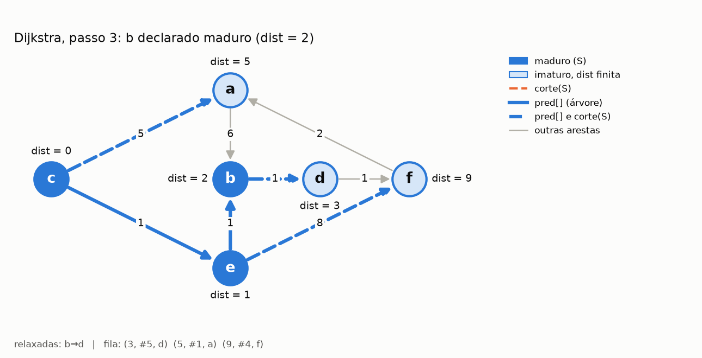
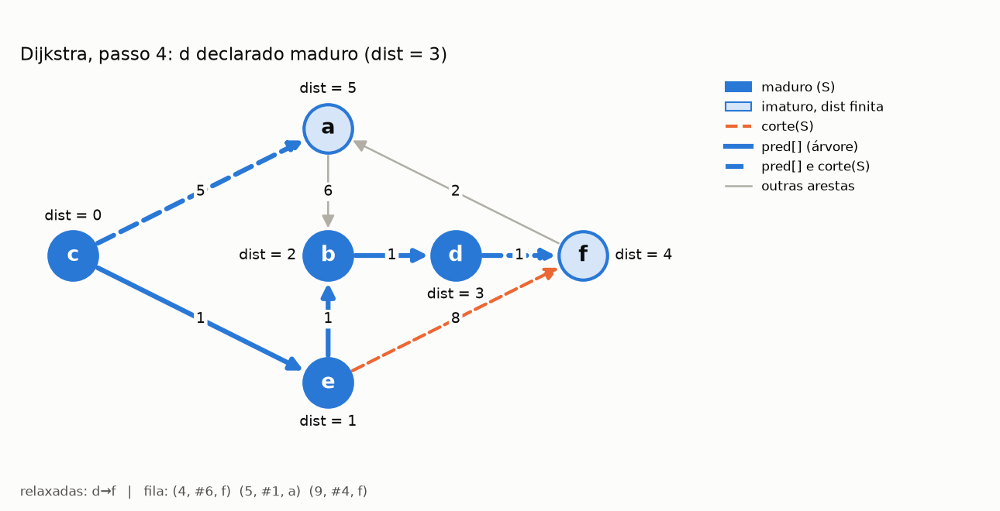
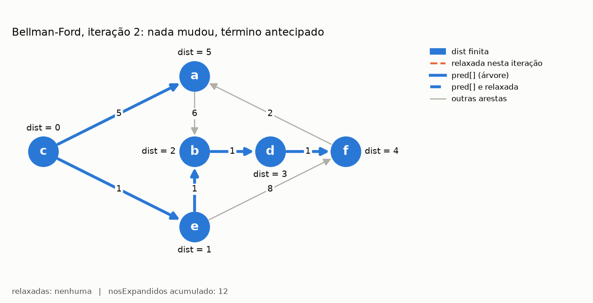

# Roteiro de explicação: `codigo/rotas.py` (Dijkstra e Bellman-Ford)

Material de estudo para o grupo explicar `rotas.py` linha por linha (Issue 07). Ordem sugerida de leitura: a visão geral, o fluxo das funções (seção 1), os exemplos com figuras (seções 3 a 5) e, por último, a tabela linha a linha (seção 2) com o código aberto ao lado.

- Os números de linha se referem à versão atual de `codigo/rotas.py`. A tabela linha a linha (seção 2), a coluna "linhas" da seção 1.3 e a tabela dos critérios da Issue 07 (seção 1.4) são **geradas** por `python docs/gerar_tabela_linha_a_linha.py`. Não edite essas partes à mão: a explicação de cada linha fica no dicionário `EXPLICACOES` desse script, e as âncoras dos critérios em `CRITERIOS_DA_ISSUE_07`.
- Depois de qualquer mudança em `rotas.py`, rode `python docs/gerar_tabela_linha_a_linha.py` e depois `python docs/conferir_roteiro.py`, que confere a tabela contra o arquivo, linha por linha. As poucas citações de linha no texto das seções 3 a 6 continuam manuais.
- As figuras e os estados dos exemplos saem de `python docs/gerar_figuras.py` (requer matplotlib, só para a documentação). O script refaz cada passo e, no fim, confere o estado final com as funções reais de `rotas.py`.

## Sumário

- [Visão geral](#visão-geral)
- [1. Fluxo na ordem de execução](#1-fluxo-na-ordem-de-execução)
- [2. Tabela linha a linha](#2-tabela-linha-a-linha)
- [3. Exemplo: Dijkstra no grafo dos slides](#3-exemplo-dijkstra-no-grafo-dos-slides)
- [4. Exemplo: Bellman-Ford no mesmo grafo](#4-exemplo-bellman-ford-no-mesmo-grafo)
- [5. Por que o Dijkstra falha com peso negativo (só no papel)](#5-por-que-o-dijkstra-falha-com-peso-negativo-só-no-papel)
- [6. Perguntas prováveis na apresentação](#6-perguntas-prováveis-na-apresentação)

## Visão geral

`rotas.py` tem duas funções públicas, com a mesma entrada e a mesma saída:

```python
calcularRotaDijkstra(grafo, origem, destino, criterio) -> ResultadoRota
calcularRotaBellmanFord(grafo, origem, destino, criterio) -> ResultadoRota
```

- `grafo`: o `Grafo` dirigido de `grafo.py`, montado por `mapa.construir_grafo`.
- `origem`, `destino`: **ids** dos vértices (texto), como em `Grafo.existeVertice`.
- `criterio`: `'distancia'` (m), `'tempo'` (s) ou `'custo'` (R$). Maiúsculas e espaços são aceitos; acento não (`'Distância'` é inválido).

As outras seis funções começam com `_` (uso interno, mesma convenção de `_validarNumeroFinito` em `grafo.py`). Cada algoritmo fica com o seu laço principal dentro da própria função pública; o que é igual nos dois (validar, inicializar, relaxar, reconstruir, montar o resultado) é compartilhado.

**Termos dos slides, como aparecem no código**

| Slides | Código | O que é |
| --- | --- | --- |
| `dist[v]` | `distanciaAteOVertice[id]` | melhor custo conhecido da origem até o vértice; começa em infinito (`DISTANCIA_INFINITA`), e a origem começa em 0 |
| `pred[v]` | `predecessorDoVertice[id]` | **aresta** usada para chegar ao vértice (e não só o vértice anterior), para distinguir arestas paralelas |
| S (maduros) | `verticesMaduros` | vértices cuja distância já é definitiva (só no Dijkstra) |
| aresta (v, w) tensa | `novaDistancia < distanciaAteOVertice[verticeVizinho]` em `_relaxarSeTensa` | `dist[v] + d(v, w) < dist[w]` |
| relaxação | `_relaxarSeTensa` | `dist[w] = dist[v] + d(v, w)` e `pred[w] = aresta (v, w)` |
| fila de prioridade | `filaDePrioridade` (lista + `heapq`) | heap com entradas `(distância, desempate, id)` |

**Regras iguais nos dois algoritmos**

1. Critério inválido, origem ou destino inexistente: `ResultadoRota.invalida()`. Nunca é confundido com "sem caminho".
2. `origem == destino`: rota `'encontrada'`, sem arestas, totais 0 e `nosExpandidos = 0`.
3. Destino sem caminho: `ResultadoRota.inalcancavel(nosExpandidos)`.
4. Caso normal: o caminho é reconstruído por `pred[]` e entregue a `ResultadoRota.aPartirDoCaminho`, que soma os pesos das próprias arestas. Por isso o total informado é sempre a soma das arestas do caminho.
5. **Empate**: só relaxamos com "estritamente menor". Com custo igual a aresta não está tensa e a primeira estimativa encontrada é mantida.

**`nosExpandidos` não é comparável entre os dois**

- Dijkstra: quantos vértices foram declarados maduros (cada vértice conta no máximo uma vez).
- Bellman-Ford: soma, em todas as iterações, dos vértices com `dist` finita cujas arestas de saída foram examinadas (o mesmo vértice conta uma vez **por iteração**). A passada extra de ciclo negativo não entra na soma.

No grafo dos slides, indo de c até a, o Dijkstra expande 6 e o Bellman-Ford 12, e os dois acham o mesmo custo.

**Complexidade** (V = vértices, E = arestas)

- Dijkstra com heap e remoção preguiçosa: O((V + E) log E). Cada aresta é examinada uma vez (quando a origem dela amadurece) e gera no máximo uma inserção, então o heap tem até E + 1 entradas, e cada inserção ou remoção custa O(log E). Quando E ≤ V², log E ≤ 2 log V, então isso é o mesmo que O((V + E) log V).
- Bellman-Ford: O(V · E). São até V − 1 iterações, e cada uma examina até E arestas. O término antecipado costuma parar bem antes.

## 1. Fluxo na ordem de execução

### 1.1 Dijkstra

```text
calcularRotaDijkstra
├─ _verificarSolicitacao ──────── normalizarCriterio, Grafo.existeVertice,
│                                 ResultadoRota.invalida / aPartirDoCaminho
├─ _inicializarEstimativas ────── Grafo.vertices
├─ laço principal (na própria função)
│   ├─ heapq.heappop / heapq.heappush
│   ├─ Grafo.getAdjacencias
│   └─ _relaxarSeTensa ────────── Aresta.getPeso
└─ _montarResultado
    ├─ _reconstruirCaminho
    └─ ResultadoRota.inalcancavel / aPartirDoCaminho
```

### 1.2 Bellman-Ford

```text
calcularRotaBellmanFord
├─ _verificarSolicitacao, _inicializarEstimativas          (as mesmas do Dijkstra)
├─ laço de até |V| − 1 iterações (na própria função)
│   └─ _executarIteracaoDeBellmanFord
│       ├─ Grafo.vertices, Grafo.getAdjacencias
│       └─ _relaxarSeTensa                                  (a mesma do Dijkstra)
├─ passada extra: _executarIteracaoDeBellmanFord            (só se a última iteração relaxou)
└─ _montarResultado                                         (a mesma do Dijkstra)
```

### 1.3 Cada função: entra, sai, por que existe

Na ordem em que são executadas numa chamada de `calcularRotaDijkstra`, seguidas das que só o Bellman-Ford usa.

<!-- funcoes:inicio -->
| ordem | função | linhas | entra | sai | por que existe |
| --- | --- | --- | --- | --- | --- |
| 1 | `calcularRotaDijkstra` | 107–148 | grafo, origem, destino, critério | `ResultadoRota` | Ponto de entrada público e o algoritmo inteiro: valida, inicializa, roda o laço dos slides (seleciona no heap o imaturo de menor dist, declara maduro, para no destino, relaxa as arestas de saída) e monta o resultado. |
| 2 | `_verificarSolicitacao` | 38–49 | grafo, origem, destino, critério | `ResultadoRota` pronto ou `None` | Separa os pedidos que não precisam de busca (critério inválido, vértice inexistente, origem = destino) do caso que precisa. Os dois algoritmos usam a mesma regra. |
| 3 | `_inicializarEstimativas` | 53–59 | grafo, origem | `(dist, pred)` | Inicialização dos slides: dist infinita, origem 0, pred indefinido. Compartilhada. |
| 4 | `_relaxarSeTensa` | 63–73 | aresta, critério, dist, pred | `True` se relaxou | Definição de aresta tensa (com `<` estrito, a regra de empate) e relaxação num lugar só, usada pelos dois algoritmos. `dist[v] + d(v, w)` é calculado uma única vez. |
| 5 | `_montarResultado` | 91–98 | dist, pred, origem, destino, nosExpandidos | `ResultadoRota` | Decide entre `'inalcancavel'` e `'encontrada'` e entrega o caminho a `aPartirDoCaminho`, que soma os totais. |
| 6 | `_reconstruirCaminho` | 77–87 | pred, origem, destino | lista de arestas | Anda de trás para frente por pred[] e inverte a lista. |
| 7 | `calcularRotaBellmanFord` | 157–196 | grafo, origem, destino, critério | `ResultadoRota` | Ponto de entrada público do Bellman-Ford: mesma validação, inicialização e montagem; o laço de até \|V\| − 1 iterações, com término antecipado, e a passada extra de ciclo negativo. |
| 8 | `_executarIteracaoDeBellmanFord` | 200–213 | grafo, critério, dist, pred | `(vértices examinados, relaxou?)` | Uma iteração: examina as arestas de saída de cada vértice alcançado e relaxa as tensas. É usada no laço e na passada extra: se a passada extra ainda relaxa alguma aresta, ela estava tensa depois de \|V\| − 1 iterações, e isso prova que há ciclo negativo alcançável. |
<!-- funcoes:fim -->

### 1.4 Critérios de aceite da Issue 07 no código

Os critérios vêm de `artefatos/planejamento/issues_github.md`. Tabela gerada a partir de trechos do código, com os testes de `test_rotas_dijkstra_bellman_ford.py` que conferem cada um.

<!-- criterios-issue-07:inicio -->
| critério de aceite | onde está em `codigo/rotas.py` | testes que conferem |
| --- | --- | --- |
| Busca retorna caminho mínimo para cada critério com pesos não negativos. | laço do Dijkstra: linhas 132–145; iterações do Bellman-Ford: linhas 181–187; relaxação com o peso do critério (`getPeso`): linhas 67–73 | `test_cada_criterio_escolhe_sua_rota`, `test_grafo_dos_slides`, `test_validacao_cruzada_mapa_real` |
| Caminho respeita direção e arestas reais; custos consolidados conferem. | só arestas que saem de v (Dijkstra): linha 140; só arestas que saem de v (Bellman-Ford): linha 210; pred[] guarda a própria aresta: linha 71; reconstrução por pred[]: linhas 77–87; totais somados das arestas do caminho: linha 98 | `test_mao_unica_nao_pode_ser_percorrida_ao_contrario`, `test_aresta_paralela_mais_barata_e_escolhida` |
| Origem=destino retorna custo zero; destino inalcançável tem estado próprio. | origem = destino: linhas 47–48; inalcançável: linhas 95–96 | `test_origem_igual_ao_destino_tem_custo_zero`, `test_destino_inalcancavel_tem_estado_proprio` |
| Solicitação/critério inválido é diferenciado de falta de caminho. | critério inválido: linhas 41–44; vértice inexistente: linhas 45–46; ciclo negativo (Bellman-Ford): linhas 192–193 | `test_vertice_inexistente_e_pedido_invalido`, `test_criterio_invalido_e_pedido_invalido`, `test_bellman_ford_detecta_ciclo_negativo_alcancavel` |
| Resultado tem os campos acordados, incluindo nós processados. | nosExpandidos do Dijkstra (vértices maduros): linha 147; nosExpandidos do Bellman-Ford (soma por iteração): linha 185; vértices examinados numa iteração: linha 209; construtores do `ResultadoRota`: linhas 96–98 | `test_dijkstra_conta_vertices_maduros_e_para_no_destino`, `test_bellman_ford_soma_vertices_examinados_por_iteracao` |
| Nenhuma biblioteca externa é usada para executar a busca. | imports (só `heapq`, `typing` e `grafo`): linhas 17–20 | `test_rotas_usa_somente_biblioteca_padrao_e_grafo` |
<!-- criterios-issue-07:fim -->

## 2. Tabela linha a linha

Linhas em branco foram omitidas. Comentários e docstrings aparecem como intervalos (não executam); cada linha que executa tem a sua própria linha na tabela. Tabela gerada por `docs/gerar_tabela_linha_a_linha.py`.

<!-- tabela-linha-a-linha:inicio -->
| linha | código | o que faz |
| --- | --- | --- |
| 1–15 | `"""` | Docstring do módulo (documentação, não executa): "Caminho mínimo no grafo viário: Método de Dijkstra e algoritmo de Bellman-Ford." |
| 17 | `import heapq` | Importa o `heapq`, da biblioteca padrão: funções que tratam uma lista comum como heap mínimo (fila de prioridade). Só o Dijkstra usa. |
| 18 | `from typing import Dict, List, Optional, Set, Tuple` | Tipos das anotações: `Dict`, `List`, `Optional` (valor ou `None`), `Set` e `Tuple`. Anotações não mudam a execução; documentam o que entra e sai. |
| 20 | `from grafo import Aresta, Grafo, ResultadoRota, normalizarCriterio` | Reaproveita o grafo.py: `Aresta` e `Grafo` (anotações e leitura), `ResultadoRota` (o que devolvemos) e `normalizarCriterio` (valida o critério). |
| 22 | `# "infinito" dos slides: dist[] de quem ainda não foi alcançado` | Comentário sobre a linha 23 (não executa). |
| 23 | `DISTANCIA_INFINITA: float = float("inf")` | O infinito do Python. Qualquer número finito é menor que ele, então serve como estimativa inicial de "nenhum caminho conhecido". |
| 25 | `# dist[]: id do vértice -> melhor custo conhecido desde a origem` | Comentário sobre a linha 26 (não executa). |
| 26 | `DistanciasPorVertice = Dict[str, float]` | Apelido de tipo para dist[]: dicionário id (texto) -> custo (float). Só encurta as assinaturas. |
| 28 | `# pred[]: id do vértice -> aresta usada para chegar nele (None = indefinido)` | Comentário sobre a linha 29 (não executa). |
| 29 | `PredecessoresPorVertice = Dict[str, Optional[Aresta]]` | Apelido de tipo para pred[]: id -> `Aresta` ou `None`. Guarda a aresta, e não o vértice, para distinguir arestas paralelas. |
| 32–34 | `# Funções compartilhadas pelos dois algoritmos` | Título de seção (comentário, não executa). |
| 37 | `# Responde sem buscar os pedidos inválidos e o de origem = destino; None = a busca deve rodar.` | Frase que resume a função `_verificarSolicitacao` (não executa). |
| 38 | `def _verificarSolicitacao(` | Define a função que resolve os pedidos que não precisam de busca. O `_` no início indica uso interno do módulo. |
| 39 | `grafo: Grafo, origem: str, destino: str, criterio: str` | Parâmetros: o grafo, os ids (texto) da origem e do destino e o critério como foi digitado. |
| 40 | `) -> Optional[ResultadoRota]:` | Devolve um `ResultadoRota` pronto ou `None` ("pode buscar"). |
| 41 | `try:` | Abre um bloco protegido: se a linha seguinte lançar `ValueError`, a execução pula para o `except`. |
| 42 | `normalizarCriterio(criterio)` | Só valida: tira espaços, passa para minúsculas e confere se é 'distancia', 'tempo' ou 'custo'. O valor limpo não precisa ser guardado, porque `getPeso` normaliza o critério sozinho. |
| 43 | `except ValueError:` | Captura só `ValueError` (critério desconhecido, vazio, `None` ou número). |
| 44 | `return ResultadoRota.invalida()` | Pedido inválido: resultado 'invalida', sem caminho e sem totais. |
| 45 | `if not grafo.existeVertice(origem) or not grafo.existeVertice(destino):` | Basta um dos dois não existir. Sem esta checagem, `getAdjacencias` devolveria lista vazia e o pedido sairia, errado, como 'inalcancavel'. |
| 46 | `return ResultadoRota.invalida()` | Pedido inválido: resultado 'invalida', sem caminho e sem totais. |
| 47 | `if origem == destino:` | Caso trivial: partida e chegada são o mesmo vértice. |
| 48 | `return ResultadoRota.aPartirDoCaminho([], nosExpandidos=0)` | Rota 'encontrada' com caminho vazio: soma de zero arestas, então distância, tempo e custo valem 0, e nosExpandidos = 0. |
| 49 | `return None` | Nenhum caso especial: quem chamou segue para a busca. |
| 52 | `# Cria dist[] (infinito, exceto a origem = 0) e pred[] (todos indefinidos), como nos slides.` | Frase que resume a função `_inicializarEstimativas` (não executa). |
| 53 | `def _inicializarEstimativas(` | Define a inicialização de dist[] e pred[], igual nos dois algoritmos. |
| 54 | `grafo: Grafo, origem: str` | Parâmetros: o grafo (de onde saem os ids) e a origem, raiz da busca. |
| 55 | `) -> Tuple[DistanciasPorVertice, PredecessoresPorVertice]:` | Devolve as duas estruturas juntas numa tupla (dist, pred). |
| 56 | `distanciaAteOVertice: DistanciasPorVertice = dict.fromkeys(grafo.vertices, DISTANCIA_INFINITA)` | `dict.fromkeys` cria um dicionário com uma chave por id de `grafo.vertices` (na ordem de inserção) e o mesmo valor em todas: infinito. Custo O(V). |
| 57 | `predecessorDoVertice: PredecessoresPorVertice = dict.fromkeys(grafo.vertices, None)` | Mesma coisa para pred[]: todo predecessor começa indefinido (`None`). |
| 58 | `distanciaAteOVertice[origem] = 0.0` | Sobrescreve a origem: chegar nela custa zero. |
| 59 | `return distanciaAteOVertice, predecessorDoVertice` | Devolve a tupla; quem chama desempacota em duas variáveis. |
| 62 | `# Relaxa a aresta (v, w) se ela estiver tensa (dist[v] + d(v, w) < dist[w]); devolve se relaxou.` | Frase que resume a função `_relaxarSeTensa` (não executa). |
| 63 | `def _relaxarSeTensa(` | Define a relaxação dos slides, usada pelos dois algoritmos. |
| 64 | `arestaDeSaida: Aresta, criterio: str,` | Parâmetros: a aresta (v, w) examinada e o critério, que decide qual peso dela vale. |
| 65 | `distanciaAteOVertice: DistanciasPorVertice, predecessorDoVertice: PredecessoresPorVertice,` | Parâmetros: dist[] e pred[]. Os dois dicionários são alterados aqui dentro (o Python passa a referência do objeto, não uma cópia). |
| 66 | `) -> bool:` | Devolve se houve relaxação. O Dijkstra usa isso para inserir w no heap; o Bellman-Ford, para saber se a iteração mudou algo. |
| 67 | `novaDistancia = distanciaAteOVertice[arestaDeSaida.origem.id] + arestaDeSaida.getPeso(criterio)` | dist[v] + d(v, w), calculado uma única vez. `arestaDeSaida.origem.id` é o id de v; `getPeso` devolve metros, segundos ou reais conforme o critério. |
| 68 | `verticeVizinho = arestaDeSaida.destino.id` | O id de w, o destino da aresta, que é a chave usada três vezes a seguir. |
| 69 | `if novaDistancia < distanciaAteOVertice[verticeVizinho]:` | Definição de aresta tensa dos slides: dist[v] + d(v, w) < dist[w]. O `<` estrito é a regra de empate: custo igual não conta como melhora. Isso também impede que arestas de peso zero formem ciclos em pred[]. |
| 70 | `distanciaAteOVertice[verticeVizinho] = novaDistancia` | Relaxação, parte 1: dist[w] recebe a nova estimativa (o mesmo valor já calculado). |
| 71 | `predecessorDoVertice[verticeVizinho] = arestaDeSaida` | Relaxação, parte 2: pred[w] recebe a própria aresta usada. Com arestas paralelas, é isso que diz qual delas foi escolhida. |
| 72 | `return True` | Informa que dist[w] e pred[w] mudaram. |
| 73 | `return False` | Aresta não tensa: nada mudou. |
| 76 | `# Segue pred[] do destino até a origem e devolve as arestas na ordem do percurso.` | Frase que resume a função `_reconstruirCaminho` (não executa). |
| 77 | `def _reconstruirCaminho(` | Define a reconstrução do caminho a partir de pred[]. |
| 78 | `predecessorDoVertice: PredecessoresPorVertice, origem: str, destino: str` | Parâmetros: pred[] final, a origem (onde a caminhada termina) e o destino (onde ela começa). |
| 79 | `) -> List[Aresta]:` | Devolve a lista de arestas na ordem do percurso. |
| 80 | `caminho: List[Aresta] = []` | Lista onde as arestas são coletadas, de trás para frente. |
| 81 | `verticeDoCaminho = destino` | A caminhada começa no destino. |
| 82 | `while verticeDoCaminho != origem:` | Repete até chegar à origem (a origem não tem predecessor). |
| 83 | `arestaUsada = predecessorDoVertice[verticeDoCaminho]` | Lê em pred[] a aresta usada para chegar neste vértice. |
| 84 | `caminho.append(arestaUsada)` | Guarda a aresta na lista. |
| 85 | `verticeDoCaminho = arestaUsada.origem.id` | Volta um passo: o próximo vértice é a origem dessa aresta. |
| 86 | `caminho.reverse()` | Inverte a lista no lugar: agora ela vai da origem ao destino. |
| 87 | `return caminho` | Devolve o caminho pronto. |
| 90 | `# Transforma dist[] e pred[] finais em ResultadoRota 'encontrada' ou 'inalcancavel'.` | Frase que resume a função `_montarResultado` (não executa). |
| 91 | `def _montarResultado(` | Define a montagem do resultado final, igual nos dois algoritmos. |
| 92 | `distanciaAteOVertice: DistanciasPorVertice, predecessorDoVertice: PredecessoresPorVertice,` | Parâmetros: dist[] e pred[] finais da busca. |
| 93 | `origem: str, destino: str, nosExpandidos: int,` | Parâmetros: origem, destino e o contador de nós expandidos (cada algoritmo tem a sua definição). |
| 94 | `) -> ResultadoRota:` | Devolve o `ResultadoRota`. |
| 95 | `if distanciaAteOVertice[destino] == DISTANCIA_INFINITA:` | dist[destino] ainda infinita: a busca terminou sem chegar ao destino. |
| 96 | `return ResultadoRota.inalcancavel(nosExpandidos)` | Estado próprio 'inalcancavel': pedido válido, sem caminho. Guarda quantos nós foram expandidos até desistir. |
| 97 | `caminho = _reconstruirCaminho(predecessorDoVertice, origem, destino)` | Destino alcançado: reconstrói o caminho por pred[]. |
| 98 | `return ResultadoRota.aPartirDoCaminho(caminho, nosExpandidos)` | Resultado 'encontrada'. Os totais (m, s, R$) são somados com `math.fsum` a partir das arestas do caminho, e o `ResultadoRota` ainda confere que o caminho é contínuo. |
| 101–103 | `# Método de Dijkstra (slides "Caminho Mínimo (1)")` | Título de seção (comentário, não executa). |
| 106 | `# Dijkstra: amadurece os vértices em ordem de dist (heap) e para quando o destino amadurece.` | Frase que resume a função `calcularRotaDijkstra` (não executa). |
| 107 | `def calcularRotaDijkstra(` | Função pública do Dijkstra (sem `_`): é a que app.py e os testes chamam. |
| 108 | `grafo: Grafo, origem: str, destino: str, criterio: str` | Parâmetros: o grafo dirigido, os ids da origem e do destino e o critério ('distancia', 'tempo' ou 'custo'). |
| 109 | `) -> ResultadoRota:` | Devolve um `ResultadoRota`. |
| 110–124 | `"""` | Docstring de `calcularRotaDijkstra` (documentação, não executa): "Recebe os ids da origem e do destino e o critério; exige pesos não negativos." |
| 125 | `resultadoAntecipado = _verificarSolicitacao(grafo, origem, destino, criterio)` | Passo 1: confere critério, existência dos vértices e origem = destino. |
| 126 | `if resultadoAntecipado is not None:` | Se já existe uma resposta... |
| 127 | `return resultadoAntecipado` | ...devolve sem rodar a busca. |
| 128 | `distanciaAteOVertice, predecessorDoVertice = _inicializarEstimativas(grafo, origem)` | Passo 2: cria dist[] e pred[] e desempacota a tupla em duas variáveis. |
| 129 | `verticesMaduros: Set[str] = set()` | Passo 3: conjunto S dos slides (vértices maduros), começa vazio. Um `set` responde "está em S?" em tempo constante. |
| 130 | `filaDePrioridade: List[Tuple[float, int, str]] = [(0.0, 0, origem)]` | O heap é uma lista comum de tuplas (distância, desempate, id). Começa só com a origem: distância 0 e desempate 0. Uma lista de um elemento já é um heap válido. |
| 131 | `proximoDesempate: int = 1` | Próximo número de desempate. Ele cresce a cada inserção: o Python compara tuplas elemento a elemento, então com distâncias iguais sai primeiro quem entrou antes, e os ids nunca chegam a ser comparados. |
| 132 | `while filaDePrioridade:` | Laço principal: repete enquanto houver candidato. Lista vazia é falsa em Python; fila vazia = nada mais é alcançável. |
| 133 | `distanciaDaEntrada, _desempateDaEntrada, verticeAtual = heapq.heappop(filaDePrioridade)` | `heappop` remove e devolve a menor tupla em O(log n): o imaturo v de menor dist. O `_` no nome do desempate indica que ele não é usado depois. |
| 134 | `if (verticeAtual in verticesMaduros` | Remoção preguiçosa: a entrada é velha se v já está maduro... |
| 135 | `or distanciaDaEntrada > distanciaAteOVertice[verticeAtual]):` | ...ou se a distância gravada nela é maior que dist[v] atual (houve melhora depois que ela entrou). O `heapq` não sabe diminuir a chave de uma entrada, então a velha fica na fila e é ignorada aqui. |
| 136 | `continue` | Descarta a entrada velha e volta ao início do `while`. |
| 137 | `verticesMaduros.add(verticeAtual)` | Declara v maduro: dist[v] é definitiva. É isso que nosExpandidos conta. |
| 138 | `if verticeAtual == destino:` | Se quem amadureceu é o destino... |
| 139 | `break` | ...sai do `while`: o caminho mínimo até ele já está em pred[]. |
| 140 | `for arestaDeSaida in grafo.getAdjacencias(verticeAtual):` | Percorre as arestas que SAEM de v. A mão única é respeitada porque só existe aresta no sentido permitido. |
| 141 | `if _relaxarSeTensa(arestaDeSaida, criterio, distanciaAteOVertice, predecessorDoVertice):` | Relaxa a aresta (v, w) se ela estiver tensa; dist[] e pred[] são alterados lá dentro. |
| 142 | `verticeVizinho = arestaDeSaida.destino.id` | Relaxou: pega o id de w... |
| 143 | `entrada = (distanciaAteOVertice[verticeVizinho], proximoDesempate, verticeVizinho)` | ...monta a entrada (nova dist[w], desempate, id de w)... |
| 144 | `heapq.heappush(filaDePrioridade, entrada)` | ...e insere no heap em O(log n). Uma entrada antiga de w pode continuar na fila; ela será descartada quando sair. |
| 145 | `proximoDesempate += 1` | Avança o desempate para a próxima inserção. |
| 146 | `return _montarResultado(` | Passo 4: transforma dist[] e pred[] no `ResultadoRota`... |
| 147 | `distanciaAteOVertice, predecessorDoVertice, origem, destino, len(verticesMaduros)` | ...com nosExpandidos = quantidade de vértices maduros (`len` do conjunto S). |
| 148 | `)` | Fecha os parênteses da chamada aberta nas linhas anteriores. |
| 151–153 | `# Algoritmo de Bellman-Ford (slides "Caminho Mínimo (2)")` | Título de seção (comentário, não executa). |
| 156 | `# Bellman-Ford: até \|V\| - 1 iterações de relaxação e uma passada extra que detecta ciclo negativo.` | Frase que resume a função `calcularRotaBellmanFord` (não executa). |
| 157 | `def calcularRotaBellmanFord(` | Função pública do Bellman-Ford, com a mesma assinatura do Dijkstra. |
| 158 | `grafo: Grafo, origem: str, destino: str, criterio: str` | Mesmos parâmetros do Dijkstra. |
| 159 | `) -> ResultadoRota:` | Devolve um `ResultadoRota`. |
| 160–174 | `"""` | Docstring de `calcularRotaBellmanFord` (documentação, não executa): "Mesma entrada e saída do Dijkstra, mas aceita peso negativo e devolve 'invalida' se houver" |
| 175 | `resultadoAntecipado = _verificarSolicitacao(grafo, origem, destino, criterio)` | Passo 1: a mesma validação do Dijkstra. |
| 176 | `if resultadoAntecipado is not None:` | Se já existe uma resposta... |
| 177 | `return resultadoAntecipado` | ...devolve sem rodar a busca. |
| 178 | `distanciaAteOVertice, predecessorDoVertice = _inicializarEstimativas(grafo, origem)` | Passo 2: a mesma inicialização do Dijkstra. |
| 179 | `nosExpandidos: int = 0` | Passo 3: soma dos vértices examinados em todas as iterações. |
| 180 | `houveRelaxacao: bool = False` | Se a iteração mais recente relaxou alguma aresta; cada iteração sobrescreve. |
| 181 | `for _numeroDaIteracao in range(len(grafo.vertices) - 1):` | Repete no máximo \|V\| - 1 vezes, o limite dos slides. O número da iteração não é usado (por isso o `_`). |
| 182 | `verticesExaminados, houveRelaxacao = _executarIteracaoDeBellmanFord(` | Executa uma iteração completa e desempacota (vértices examinados, se relaxou algo)... |
| 183 | `grafo, criterio, distanciaAteOVertice, predecessorDoVertice` | Argumentos da iteração: grafo, critério, dist[] e pred[]. |
| 184 | `)` | Fecha os parênteses da chamada aberta nas linhas anteriores. |
| 185 | `nosExpandidos += verticesExaminados` | Acumula os vértices examinados nesta iteração. |
| 186 | `if not houveRelaxacao:` | Se a iteração não relaxou nenhuma aresta... |
| 187 | `break` | ...término antecipado: sai do `for`. |
| 188 | `if houveRelaxacao:` | Passo 4: só é `True` se rodaram as \|V\| - 1 iterações e a última ainda relaxou; só nesse caso pode haver ciclo negativo. |
| 189 | `_verticesDaPassadaExtra, aindaHaArestaTensa = _executarIteracaoDeBellmanFord(` | Passada extra: mais uma iteração. Se ela ainda relaxar, alguma aresta continua tensa depois de \|V\| - 1 iterações. Os vértices dela não entram em nosExpandidos (`_`). |
| 190 | `grafo, criterio, distanciaAteOVertice, predecessorDoVertice` | Argumentos da iteração: grafo, critério, dist[] e pred[]. |
| 191 | `)` | Fecha os parênteses da chamada aberta nas linhas anteriores. |
| 192 | `if aindaHaArestaTensa:` | Ainda havia aresta tensa... |
| 193 | `return ResultadoRota.invalida()` | ...ciclo de custo negativo alcançável: não existe caminho mínimo, o pedido é 'invalida'. |
| 194 | `return _montarResultado(` | Passo 5: igual ao Dijkstra... |
| 195 | `distanciaAteOVertice, predecessorDoVertice, origem, destino, nosExpandidos` | ...com o nosExpandidos somado nas iterações. |
| 196 | `)` | Fecha os parênteses da chamada aberta nas linhas anteriores. |
| 199 | `# Relaxa as arestas que saem de cada vértice alcançado; devolve (examinados, houve relaxação).` | Frase que resume a função `_executarIteracaoDeBellmanFord` (não executa). |
| 200 | `def _executarIteracaoDeBellmanFord(` | Define uma iteração do Bellman-Ford, usada no laço e na passada extra. |
| 201 | `grafo: Grafo, criterio: str,` | Parâmetros: o grafo e o critério. |
| 202 | `distanciaAteOVertice: DistanciasPorVertice, predecessorDoVertice: PredecessoresPorVertice,` | Parâmetros: dist[] e pred[], alterados pela relaxação. |
| 203 | `) -> Tuple[int, bool]:` | Devolve a tupla (vértices examinados, se alguma aresta foi relaxada). |
| 204 | `verticesExaminados: int = 0` | Contador de vértices examinados nesta iteração. |
| 205 | `houveRelaxacao: bool = False` | Vira `True` se alguma aresta for relaxada. |
| 206 | `for verticeAtual in grafo.vertices:` | Percorre os ids de todos os vértices na ordem de inserção (percorrer um dicionário dá as chaves). |
| 207 | `if distanciaAteOVertice[verticeAtual] == DISTANCIA_INFINITA:` | Vértice ainda não alcançado: infinito + peso continua infinito e não deixa nenhuma aresta tensa... |
| 208 | `continue` | ...então é pulado e não conta como expandido. |
| 209 | `verticesExaminados += 1` | Conta este vértice como expandido nesta iteração. |
| 210 | `for arestaDeSaida in grafo.getAdjacencias(verticeAtual):` | Percorre as arestas de saída de v. |
| 211 | `if _relaxarSeTensa(arestaDeSaida, criterio, distanciaAteOVertice, predecessorDoVertice):` | Relaxa a aresta se ela estiver tensa (a mesma função do Dijkstra)... |
| 212 | `houveRelaxacao = True` | ...e registra que a iteração mudou dist[]. |
| 213 | `return verticesExaminados, houveRelaxacao` | Devolve os dois resultados da iteração. |
<!-- tabela-linha-a-linha:fim -->

## 3. Exemplo: Dijkstra no grafo dos slides

Grafo dos slides "Caminho Mínimo (1)", raiz **c**: c→a 5, c→e 1, a→b 6, e→b 1, e→f 8, b→d 1, d→f 1, f→a 2. Executamos `calcularRotaDijkstra(grafo, "c", "a", ...)`: como **a** é o último a amadurecer, o passo a passo mostra a árvore inteira.

Em cada passo: **S** é o conjunto dos maduros; **corte(S)** são as arestas (v, w) com v em S e w fora de S, cada uma com o valor `dist[v] + d(v, w)`. O próximo vértice selecionado é a ponta da aresta do corte com menor valor, que é o mesmo que o imaturo de menor `dist`. A fila mostra `(distância, contador de desempate, vértice)`, em ordem.

| passo | selecionado | S | corte(S): dist[v] + d(v, w) | dist (a, b, c, d, e, f) | pred (o que mudou) | fila depois do passo |
| --- | --- | --- | --- | --- | --- | --- |
| 0 | — | { } | — | ∞, ∞, 0, ∞, ∞, ∞ | todos indefinidos | (0, #0, c) |
| 1 | c | {c} | c→a 5, **c→e 1** | 5, ∞, 0, ∞, 1, ∞ | a: c→a; e: c→e | (1, #2, e) (5, #1, a) |
| 2 | e | {c, e} | c→a 5, **e→b 2**, e→f 9 | 5, 2, 0, ∞, 1, 9 | b: e→b; f: e→f | (2, #3, b) (5, #1, a) (9, #4, f) |
| 3 | b | {c, e, b} | c→a 5, e→f 9, **b→d 3** | 5, 2, 0, 3, 1, 9 | d: b→d | (3, #5, d) (5, #1, a) (9, #4, f) |
| 4 | d | {c, e, b, d} | c→a 5, e→f 9, **d→f 4** | 5, 2, 0, 3, 1, 4 | f: d→f (melhorou de 9 para 4) | (4, #6, f) (5, #1, a) (9, #4, f) |
| 5 | f | {c, e, b, d, f} | **c→a 5**, f→a 6 | 5, 2, 0, 3, 1, 4 | nada (f→a: 4 + 2 = 6 não é < 5) | (5, #1, a) (9, #4, f) |
| 6 | a | todos | vazio | 5, 2, 0, 3, 1, 4 | nada: a é o destino, a busca para | (9, #4, f) |

Em negrito, a aresta do corte de menor valor, que define quem é selecionado no passo seguinte.

Resultado final: **c = 0, e = 1, b = 2, d = 3, f = 4, a = 5**. Rota até a: `c→a` (custo 5), `nosExpandidos = 6`.

Pontos que valem comentar:

- **Passo 4, remoção preguiçosa**: f melhora de 9 para 4. O `heapq` não sabe diminuir a chave da entrada `(9, #4, f)`, então f é inserido de novo como `(4, #6, f)`. A entrada velha fica na fila. Se ela saísse, seria ignorada porque f já estaria maduro (remoção preguiçosa, linhas 134–136). No passo 6 a busca para antes disso, e ela sobra na fila.
- **Passo 5**: f→a está no corte, mas `dist[f] + 2 = 6` não é menor que `dist[a] = 5`. A aresta não está tensa e pred[a] continua `c→a`.
- **Passo 6**: a é o destino e a busca para na linha 139, sem examinar a→b. Nos slides as arestas de v são examinadas antes de declarar v maduro. No código, v é declarado maduro primeiro (linha 137). Com pesos não negativos dá no mesmo, porque nenhuma aresta de v consegue melhorar `dist[v]`. A vantagem é poder parar no destino sem trabalho extra.
- Indo de c até e, a busca para no passo 2 e devolve `nosExpandidos = 2`.

| | |
| --- | --- |
|  |  |
|  |  |
|  |  |
|  | |

Legenda das figuras: azul cheio = maduro (S); azul claro = imaturo com dist finita (está na fila); laranja tracejado = aresta do corte(S); azul grosso = aresta em pred[] (árvore de caminhos); azul tracejado = aresta em pred[] que também está no corte. O rodapé mostra as relaxações do passo e a fila.

## 4. Exemplo: Bellman-Ford no mesmo grafo

A ordem dos vértices é a de inserção no `Grafo`. `adicionarAresta` insere a origem e depois o destino de cada aresta, então a ordem fica **c, a, e, b, f, d**. Com 6 vértices, o limite é \|V\| − 1 = **5 iterações**.

**Iteração 1, vértice por vértice** (as melhorias feitas no meio da iteração já valem para os vértices seguintes):

| vértice examinado | dist[v] na hora | aresta | dist[v] + d(v, w) | tensa? | efeito |
| --- | --- | --- | --- | --- | --- |
| c | 0 | c→a | 0 + 5 = 5 | sim (5 < ∞) | a = 5, pred[a] = c→a |
| | | c→e | 0 + 1 = 1 | sim (1 < ∞) | e = 1, pred[e] = c→e |
| a | 5 | a→b | 5 + 6 = 11 | sim (11 < ∞) | b = 11, pred[b] = a→b |
| e | 1 | e→b | 1 + 1 = 2 | sim (2 < 11) | b = 2, pred[b] = e→b |
| | | e→f | 1 + 8 = 9 | sim (9 < ∞) | f = 9, pred[f] = e→f |
| b | 2 | b→d | 2 + 1 = 3 | sim (3 < ∞) | d = 3, pred[d] = b→d |
| f | 9 | f→a | 9 + 2 = 11 | não (11 ≥ 5) | — |
| d | 3 | d→f | 3 + 1 = 4 | sim (4 < 9) | f = 4, pred[f] = d→f |

Seis vértices examinados e sete relaxações. b passou por 11 antes de chegar a 2, e f por 9 antes de chegar a 4.

**dist ao fim de cada iteração**

| iteração | a | b | c | d | e | f | relaxações | vértices examinados (acumulado) |
| --- | --- | --- | --- | --- | --- | --- | --- | --- |
| 0 (início) | ∞ | ∞ | 0 | ∞ | ∞ | ∞ | — | 0 |
| 1 | 5 | 2 | 0 | 3 | 1 | 4 | 7 | 6 |
| 2 | 5 | 2 | 0 | 3 | 1 | 4 | **0: término antecipado** | 12 |

Na iteração 2 nenhuma aresta está tensa (por exemplo, `e→b`: 1 + 1 = 2 não é < 2). A iteração não muda nada, então o laço para na linha 187 depois de 2 das 5 iterações possíveis. Como a última iteração não relaxou, `houveRelaxacao` é `False` e a passada extra de ciclo negativo (linhas 188–193) nem roda.

Resultado: mesmas distâncias do Dijkstra (c = 0, e = 1, b = 2, d = 3, f = 4, a = 5) e mesmo pred[]. `nosExpandidos = 12` para qualquer destino, porque o Bellman-Ford não para no destino.

| | |
| --- | --- |
|  |  |
|  | |

Legenda: azul cheio = dist finita; laranja tracejado = aresta relaxada nesta iteração (a→b e e→f foram relaxadas e depois superadas); azul grosso = aresta em pred[]; azul tracejado = aresta em pred[] relaxada nesta iteração.

## 5. Por que o Dijkstra falha com peso negativo (só no papel)

O `Grafo` real **não aceita** peso negativo: a classe `Aresta` lança `ValueError` (grafo.py, linhas 176–183). Este exemplo existe só para explicar a diferença entre os algoritmos. Nos testes ele roda com um grafo falso mínimo (`GrafoFalso` em `test_rotas_dijkstra_bellman_ford.py`).

Grafo: s→a 2, s→b 3, b→a −2. Correto: **dist[a] = 1**, pelo caminho s→b→a.

**Dijkstra** (destino a):

| passo | selecionado | S | dist (s, a, b) | fila |
| --- | --- | --- | --- | --- |
| 0 | — | { } | 0, ∞, ∞ | (0, #0, s) |
| 1 | s | {s} | 0, 2, 3 | (2, #1, a) (3, #2, b) |
| 2 | a | {s, a} | 0, **2**, 3 | (3, #2, b): a é o destino, a busca para |

Resposta do Dijkstra: rota s→a com custo **2**, errada.

Por que erra: quando a é selecionado, o Dijkstra supõe que nenhum outro caminho chega em a mais barato. Qualquer outro caminho teria de passar por um vértice ainda imaturo, como b, que já custa 3 ≥ 2. Com pesos não negativos, somar mais arestas nunca diminuiria esse valor. A aresta b→a de peso −2 quebra essa suposição: 3 + (−2) = 1 < 2. Mesmo se a busca continuasse, a já estaria maduro. A nova entrada de a seria descartada pela remoção preguiçosa, e qualquer vértice alcançado a partir de a teria sido calculado com o valor antigo.

**Bellman-Ford** (ordem s, a, b):

| iteração | s | a | b | o que aconteceu |
| --- | --- | --- | --- | --- |
| 0 | 0 | ∞ | ∞ | início |
| 1 | 0 | **1** | 3 | s: a = 2, b = 3; a: sem arestas de saída; b: b→a 3 − 2 = 1 < 2, a = 1 |
| 2 | 0 | 1 | 3 | nada muda: término antecipado |

Resposta do Bellman-Ford: s→b→a com custo **1**, correta. Ele não "fecha" nenhum vértice. Revisa todas as arestas a cada iteração, então uma melhora que chegue depois ainda é aproveitada.

Se houvesse um ciclo de custo negativo alcançável (por exemplo, a→b −2 e b→a 1), dist continuaria diminuindo a cada volta. Depois de \|V\| − 1 iterações ainda haveria aresta tensa, e `calcularRotaBellmanFord` devolveria `'invalida'` (linhas 188–193).

## 6. Perguntas prováveis na apresentação

**Por que `pred[]` guarda a aresta e não o vértice?**
Porque o grafo permite arestas paralelas (duas ruas de A para B). Saber só que o anterior de B é A não diz qual das duas foi usada, e cada uma tem distância, tempo e custo próprios.

**Por que "estritamente menor"?**
É a regra de empate: com custo igual, a primeira estimativa fica. Isso também evita que arestas de peso zero façam pred[] apontar em círculo. Ao trocar `<` por `<=` na linha 69, 32 testes de `test_rotas_dijkstra_bellman_ford.py` falham.

**Por que a remoção preguiçosa é correta?**
Toda vez que dist[w] melhora, w entra de novo na fila com a distância nova, que é menor. A entrada mais nova sai primeiro. As velhas saem depois e são reconhecidas porque o vértice já está maduro ou porque a distância delas é maior que a atual. O custo é ter até E + 1 entradas na fila, por isso o O((V + E) log E).

**Por que declarar maduro antes de examinar as arestas, se no slide é depois?**
Com pesos não negativos dá no mesmo, porque nenhuma aresta de v pode melhorar dist[v]. Declarando antes, a busca pode parar assim que o destino amadurece, sem examinar as arestas dele.

**Por que o Bellman-Ford precisa de no máximo \|V\| − 1 iterações?**
Um caminho mínimo sem ciclo tem no máximo \|V\| − 1 arestas. Ao fim da iteração k, todos os caminhos mínimos com até k arestas já estão em dist[].

**Por que os `nosExpandidos` dos dois não são comparáveis?**
No Dijkstra cada vértice conta no máximo uma vez. No Bellman-Ford o mesmo vértice conta em toda iteração em que é examinado. Para comparar esforço, use o tempo medido (Issue 12) ou conte arestas examinadas.

**O que acontece com um vértice que não existe? E com um critério errado?**
Os dois viram `'invalida'` antes de qualquer busca. "Sem caminho" é outro estado, `'inalcancavel'`, que só aparece quando o pedido é válido e a busca rodou sem chegar ao destino.

**Alguma biblioteca pronta faz a busca?**
Não. `rotas.py` importa só `heapq`, `typing` e o `grafo.py` do projeto. Um teste confere isso lendo os `import` do arquivo.
