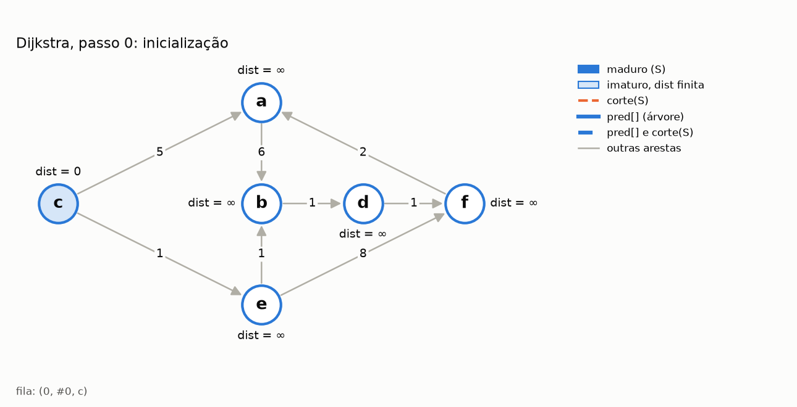
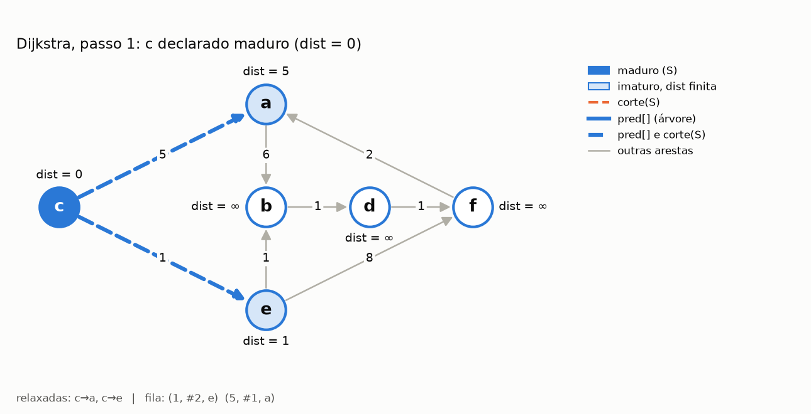
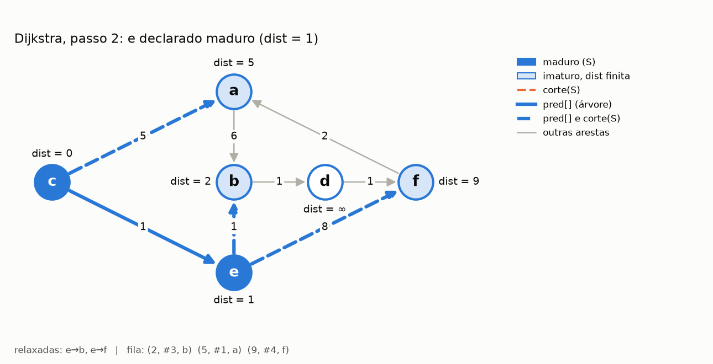
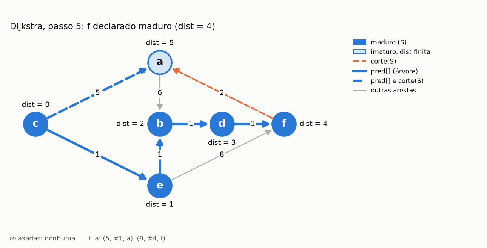
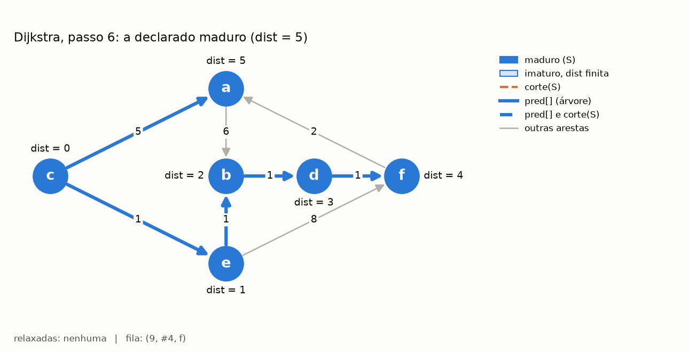
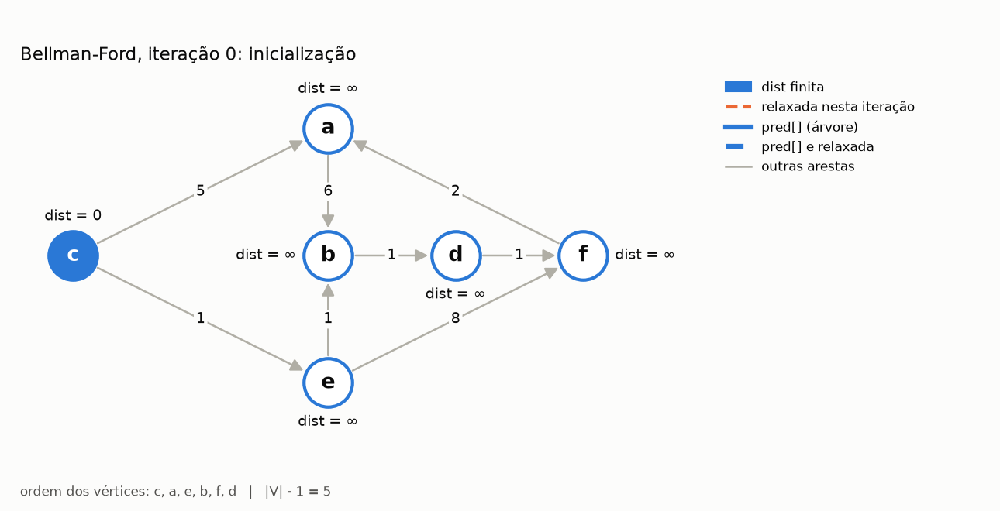
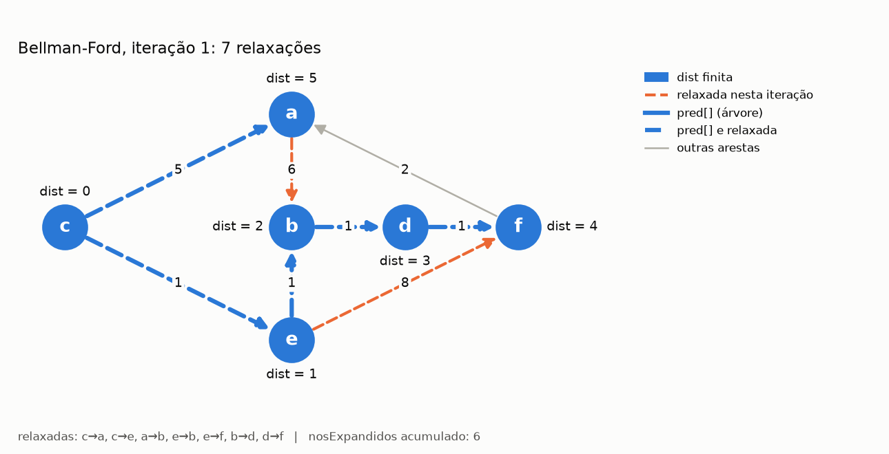

# Roteiro de explicação: `codigo/rotas.py` (Dijkstra e Bellman-Ford)

Material de estudo para o grupo explicar `rotas.py` linha por linha (Issue 07). Ordem sugerida de leitura: a visão geral, o fluxo das funções (seção 1), os exemplos com figuras (seções 3 a 5) e, por último, a tabela linha a linha (seção 2) com o código aberto ao lado.

- Os números de linha se referem à versão de `codigo/rotas.py` deste commit. Depois de qualquer mudança no arquivo, rode `python docs/conferir_roteiro.py`: ele aponta toda linha da tabela que deixou de bater.
- As figuras e os estados dos exemplos saem de `python docs/gerar_figuras.py` (requer matplotlib, só para a documentação). O script refaz cada passo e, no fim, confere o estado final com as funções reais de `rotas.py`.

## Sumário

- [Visão geral](#visão-geral)
- [1. Fluxo na ordem de execução](#1-fluxo-na-ordem-de-execução)
- [2. Tabela linha a linha](#2-tabela-linha-a-linha)
- [3. Exemplo: Dijkstra no grafo dos slides](#3-exemplo-dijkstra-no-grafo-dos-slides)
- [4. Exemplo: Bellman-Ford no mesmo grafo](#4-exemplo-bellman-ford-no-mesmo-grafo)
- [5. Por que o Dijkstra falha com peso negativo (só no papel)](#5-por-que-o-dijkstra-falha-com-peso-negativo-só-no-papel)
- [6. Perguntas prováveis na apresentação](#6-perguntas-prováveis-na-apresentação)

## Visão geral

`rotas.py` tem duas funções públicas, com a mesma entrada e a mesma saída:

```python
calcularRotaDijkstra(grafo, origem, destino, criterio) -> ResultadoRota
calcularRotaBellmanFord(grafo, origem, destino, criterio) -> ResultadoRota
```

- `grafo`: o `Grafo` dirigido de `grafo.py`, montado por `mapa.construir_grafo`.
- `origem`, `destino`: **ids** dos vértices (texto), como em `Grafo.existeVertice`.
- `criterio`: `'distancia'` (m), `'tempo'` (s) ou `'custo'` (R$). Maiúsculas e espaços são aceitos; acento não (`'Distância'` é inválido).

Todas as outras funções começam com `_` (uso interno, mesma convenção de `_validarNumeroFinito` em `grafo.py`).

**Termos dos slides, como aparecem no código**

| Slides | Código | O que é |
| --- | --- | --- |
| `dist[v]` | `distanciaAteOVertice[id]` | melhor custo conhecido da origem até o vértice; começa em infinito (`DISTANCIA_INFINITA`), e a origem começa em 0 |
| `pred[v]` | `predecessorDoVertice[id]` | **aresta** usada para chegar ao vértice (e não só o vértice anterior), para distinguir arestas paralelas |
| S (maduros) | `verticesMaduros` | vértices cuja distância já é definitiva (só no Dijkstra) |
| aresta (v, w) tensa | `_arestaEstaTensa` | `dist[v] + d(v, w) < dist[w]` |
| relaxação | `_tentarRelaxarAresta` | `dist[w] = dist[v] + d(v, w)` e `pred[w] = aresta (v, w)` |
| fila de prioridade | `_FilaDePrioridade` | heap com entradas `(distância, contador de desempate, id)` |

**Regras iguais nos dois algoritmos**

1. Critério inválido, origem ou destino inexistente: `ResultadoRota.invalida()`. Nunca é confundido com "sem caminho".
2. `origem == destino`: rota `'encontrada'`, sem arestas, totais 0 e `nosExpandidos = 0`.
3. Destino sem caminho: `ResultadoRota.inalcancavel(nosExpandidos)`.
4. Caso normal: o caminho é reconstruído por `pred[]` e entregue a `ResultadoRota.aPartirDoCaminho`, que soma os pesos das próprias arestas. Por isso o total informado é sempre a soma das arestas do caminho.
5. **Empate**: só relaxamos com "estritamente menor". Com custo igual a aresta não está tensa e a primeira estimativa encontrada é mantida.

**`nosExpandidos` não é comparável entre os dois**

- Dijkstra: quantos vértices foram declarados maduros (cada vértice conta no máximo uma vez).
- Bellman-Ford: soma, em todas as iterações, dos vértices com `dist` finita cujas arestas de saída foram examinadas (o mesmo vértice conta uma vez **por iteração**).

No grafo dos slides, indo de c até a, o Dijkstra expande 6 e o Bellman-Ford 12, e os dois acham o mesmo custo.

**Complexidade** (V = vértices, E = arestas)

- Dijkstra com heap e remoção preguiçosa: O((V + E) log E). Cada aresta é examinada uma vez (quando a origem dela amadurece) e gera no máximo uma inserção, então o heap tem até E + 1 entradas, e cada inserção ou remoção custa O(log E). Quando E ≤ V², log E ≤ 2 log V, então isso é o mesmo que O((V + E) log V).
- Bellman-Ford: O(V · E). São até V − 1 iterações, e cada uma examina até E arestas. O término antecipado costuma parar bem antes.

## 1. Fluxo na ordem de execução

### 1.1 Dijkstra

```text
calcularRotaDijkstra
├─ _tentarNormalizarCriterio ───────── normalizarCriterio (grafo.py)
├─ _verificarSolicitacao ───────────── Grafo.existeVertice, ResultadoRota.invalida / aPartirDoCaminho
├─ _listarIdsDosVertices ───────────── Grafo.vertices
├─ _inicializarEstimativas
├─ _executarLacoDeDijkstra
│   ├─ _FilaDePrioridade (inserir, retirarMenor, estaVazia) ── heapq
│   ├─ _entradaEstaDesatualizada
│   ├─ Grafo.getAdjacencias
│   └─ _tentarRelaxarAresta
│       └─ _arestaEstaTensa
│           └─ _calcularNovaDistanciaEstimada ── Aresta.getPeso
└─ _montarResultado
    ├─ _verticeFoiAlcancado
    ├─ _reconstruirCaminho
    └─ ResultadoRota.inalcancavel / aPartirDoCaminho
```

### 1.2 Bellman-Ford

```text
calcularRotaBellmanFord
├─ _tentarNormalizarCriterio, _verificarSolicitacao,
│  _listarIdsDosVertices, _inicializarEstimativas        (as mesmas do Dijkstra)
├─ _executarIteracoesDeBellmanFord
│   └─ _executarUmaIteracaoDeBellmanFord                 (até |V| − 1 vezes)
│       ├─ _verticeFoiAlcancado
│       ├─ Grafo.getAdjacencias
│       └─ _tentarRelaxarAresta → _arestaEstaTensa → _calcularNovaDistanciaEstimada
├─ _existeArestaTensa                                    (só se a última iteração relaxou)
└─ _montarResultado                                      (a mesma do Dijkstra)
```

### 1.3 Cada função: entra, sai, por que existe

Na ordem em que são executadas numa chamada de `calcularRotaDijkstra`, seguidas das que só o Bellman-Ford usa.

<!-- funcoes:inicio -->
| ordem | função | linhas | entra | sai | por que existe |
| --- | --- | --- | --- | --- | --- |
| 1 | `calcularRotaDijkstra` | 255–304 | grafo, origem, destino, critério | `ResultadoRota` | Ponto de entrada público. Só encadeia os quatro passos: validar, inicializar, laço, montar resultado. |
| 2 | `_tentarNormalizarCriterio` | 88–96 | critério digitado | critério limpo ou `None` | `normalizarCriterio` lança `ValueError`; aqui o erro vira `None` para o pedido ser respondido como `'invalida'` em vez de quebrar a interface. |
| 3 | `_verificarSolicitacao` | 99–122 | grafo, origem, destino, critério normalizado | `ResultadoRota` pronto ou `None` | Separa os pedidos que não precisam de busca (critério inválido, vértice inexistente, origem = destino) do caso que precisa. Os dois algoritmos usam a mesma regra. |
| 4 | `_listarIdsDosVertices` | 125–130 | grafo | lista de ids | O `Grafo` não tem método que liste vértices; a lista é montada a partir da propriedade `grafo.vertices`, uma vez por chamada. |
| 5 | `_inicializarEstimativas` | 133–147 | ids, origem | `(dist, pred)` | Inicialização dos slides: dist infinita, origem 0, pred indefinido. Compartilhada. |
| 6 | `_executarLacoDeDijkstra` | 307–349 | grafo, origem, destino, critério, dist, pred | `nosExpandidos` | O laço do slide: seleciona o imaturo de menor dist, declara maduro, para no destino, relaxa as arestas de saída. Altera dist e pred no lugar. |
| 7 | `_FilaDePrioridade` | 368–399 | distância e id (`inserir`) | menor entrada (`retirarMenor`) | Esconde o `heapq` e o contador de desempate atrás de três operações com nome claro. |
| 8 | `_entradaEstaDesatualizada` | 352–365 | distância da entrada, vértice, maduros, dist | `bool` | Remoção preguiçosa: decide se uma entrada que saiu da fila é velha e deve ser ignorada. |
| 9 | `_tentarRelaxarAresta` | 184–205 | aresta, critério, dist, pred | `True` se relaxou | A relaxação dos slides, usada pelos dois algoritmos. |
| 10 | `_arestaEstaTensa` | 168–181 | aresta, critério, dist | `bool` | Definição de aresta tensa com `<` estrito (regra de empate). Usada também na passada extra do Bellman-Ford. |
| 11 | `_calcularNovaDistanciaEstimada` | 156–165 | aresta, critério, dist | `dist[v] + d(v, w)` | Um único lugar que soma a distância até v com o peso da aresta no critério. |
| 12 | `_montarResultado` | 233–247 | dist, pred, origem, destino, nosExpandidos | `ResultadoRota` | Decide entre `'inalcancavel'` e `'encontrada'` e entrega o caminho a `aPartirDoCaminho`, que soma os totais. |
| 13 | `_verticeFoiAlcancado` | 150–153 | dist, id | `bool` | Pergunta "dist é finita?", usada no resultado e para pular vértices no Bellman-Ford. |
| 14 | `_reconstruirCaminho` | 208–230 | pred, origem, destino | lista de arestas | Anda de trás para frente por pred[] e inverte a lista. |
| 15 | `calcularRotaBellmanFord` | 407–467 | grafo, origem, destino, critério | `ResultadoRota` | Ponto de entrada público do Bellman-Ford: mesma validação, inicialização e montagem; troca o laço e acrescenta a detecção de ciclo negativo. |
| 16 | `_executarIteracoesDeBellmanFord` | 470–499 | grafo, ids, critério, dist, pred | `(nosExpandidos, última iteração relaxou?)` | Repete até \|V\| − 1 iterações, com término antecipado. |
| 17 | `_executarUmaIteracaoDeBellmanFord` | 502–531 | grafo, ids, critério, dist, pred | `(vértices examinados, relaxou?)` | Uma iteração: examina as arestas de saída de cada vértice alcançado e relaxa as tensas. |
| 18 | `_existeArestaTensa` | 534–550 | grafo, ids, critério, dist | `bool` | Passada extra: se ainda há aresta tensa depois de \|V\| − 1 iterações, existe ciclo de custo negativo alcançável. |
<!-- funcoes:fim -->

## 2. Tabela linha a linha

Linhas em branco foram omitidas. Comentários e docstrings aparecem como intervalos (não executam); cada linha que executa tem a sua própria linha na tabela.

<!-- tabela-linha-a-linha:inicio -->
| linha | código | o que faz |
| --- | --- | --- |
| 1–57 | `"""` | Docstring do módulo (texto de documentação, não executa): "Caminho mínimo no grafo viário: Método de Dijkstra e algoritmo de Bellman-Ford." |
| 59 | `import heapq` | Importa o `heapq`, da biblioteca padrão: funções que tratam uma lista comum como heap mínimo (fila de prioridade). Só a fila do Dijkstra usa. |
| 60 | `from typing import Dict, List, Optional, Set, Tuple` | Importa os tipos usados nas anotações: `Dict` (dicionário), `List`, `Optional` (valor ou `None`), `Set` (conjunto) e `Tuple`. Anotações não mudam a execução; documentam o que entra e sai. |
| 62 | `from grafo import Aresta, Grafo, ResultadoRota, normalizarCriterio` | Reaproveita o modelo do grafo.py: `Aresta` e `Grafo` (anotações e leitura), `ResultadoRota` (o que devolvemos) e `normalizarCriterio` (valida o critério). |
| 64 | `# "Infinito" dos slides: valor inicial de dist[] para vértice ainda…` | Comentário (não executa): explica o passo que começa na linha 65. |
| 65 | `DISTANCIA_INFINITA: float = float("inf")` | Constante com o infinito do Python. Qualquer número finito é menor que ele, então serve como estimativa inicial de "nenhum caminho conhecido". |
| 67 | `# Custo para ir da origem até ela mesma; é o valor inicial de dist[…` | Comentário (não executa): explica o passo que começa na linha 68. |
| 68 | `DISTANCIA_DA_ORIGEM: float = 0.0` | Constante 0.0: valor inicial de dist[origem]. |
| 70 | `# Nós expandidos quando a busca nem precisa rodar (origem igual ao…` | Comentário (não executa): explica o passo que começa na linha 71. |
| 71 | `NENHUM_NO_EXPANDIDO: int = 0` | Constante 0: nós expandidos quando a busca nem roda (origem = destino). |
| 73 | `# dist[]: id do vértice -> melhor custo conhecido desde a origem.` | Comentário (não executa): explica o passo que começa na linha 74. |
| 74 | `DistanciasPorVertice = Dict[str, float]` | Apelido de tipo para dist[]: dicionário id (texto) -> custo (float). Só deixa as assinaturas mais curtas e legíveis. |
| 76 | `# pred[]: id do vértice -> aresta usada para chegar nele (None = in…` | Comentário (não executa): explica o passo que começa na linha 77. |
| 77 | `PredecessoresPorVertice = Dict[str, Optional[Aresta]]` | Apelido de tipo para pred[]: id -> `Aresta` ou `None`. Guarda a aresta, e não o vértice, para distinguir arestas paralelas. |
| 79 | `# Entrada da fila de prioridade: (distância estimada, contador de d…` | Comentário (não executa): explica o passo que começa na linha 80. |
| 80 | `EntradaDaFila = Tuple[float, int, str]` | Apelido de tipo das entradas do heap: (distância, contador de desempate, id). O Python compara tuplas elemento a elemento: primeiro a distância, depois o contador. |
| 83–85 | `# Funções compartilhadas pelos dois algoritmos` | Título de seção (comentário, não executa). |
| 88 | `def _tentarNormalizarCriterio(criterio: str) -> Optional[str]:` | Define a função auxiliar. O `_` no início do nome indica uso interno do módulo (mesma convenção de `_validarNumeroFinito` em grafo.py). Recebe o critério digitado e devolve o critério limpo ou `None`. |
| 89 | `"""Devolve 'distancia', 'tempo' ou 'custo', ou None se o critério for inválido."""` | Docstring de `_tentarNormalizarCriterio` (texto de documentação, não executa): "Devolve 'distancia', 'tempo' ou 'custo', ou None se o critério for inválido." |
| 90–92 | `# normalizarCriterio (grafo.py) aceita maiúsculas e espaços extras…` | Comentário (não executa): explica o passo que começa na linha 93. |
| 93 | `try:` | Abre um bloco protegido: se a linha seguinte lançar `ValueError`, a execução pula para o `except`. |
| 94 | `return normalizarCriterio(criterio)` | Chama `normalizarCriterio` do grafo.py: tira espaços, passa para minúsculas e confere se é 'distancia', 'tempo' ou 'custo'. Se for válido, devolve o texto limpo. |
| 95 | `except ValueError:` | Captura só `ValueError` (critério desconhecido, vazio, `None` ou número). Outros erros não são escondidos. |
| 96 | `return None` | Sinaliza "critério inválido" com `None`, sem lançar exceção. |
| 99 | `def _verificarSolicitacao(` | Início da assinatura da função que resolve os pedidos que não precisam de busca. |
| 100 | `grafo: Grafo,` | Parâmetro: o grafo dirigido onde a busca acontece (só é lido, nunca alterado). |
| 101 | `origem: str,` | Parâmetro: id (texto) do vértice de partida. |
| 102 | `destino: str,` | Parâmetro: id (texto) do vértice de chegada. |
| 103 | `criterioNormalizado: Optional[str],` | Parâmetro: o critério já normalizado, ou `None` se ele era inválido. |
| 104 | `) -> Optional[ResultadoRota]:` | Fecha a assinatura: devolve um `ResultadoRota` pronto ou `None` ("pode buscar"). |
| 105–110 | `"""` | Docstring de `_verificarSolicitacao` (texto de documentação, não executa): "Resolve os pedidos que não precisam de busca." |
| 111 | `# critério inválido: _tentarNormalizarCriterio devolveu None` | Comentário (não executa): explica o passo que começa na linha 112. |
| 112 | `if criterioNormalizado is None:` | Testa se o critério foi recusado na normalização. |
| 113 | `return ResultadoRota.invalida()` | Devolve o resultado 'invalida' (sem caminho e sem totais) pelo construtor do grafo.py. |
| 114–115 | `# vértice inexistente é pedido inválido, e não falta de caminho; ch…` | Comentário (não executa): explica o passo que começa na linha 116. |
| 116 | `if not grafo.existeVertice(origem) or not grafo.existeVertice(destino):` | Pergunta ao `Grafo` se origem e destino existem; basta um não existir. Sem esta checagem, `getAdjacencias` devolveria lista vazia e o pedido sairia, errado, como 'inalcancavel'. |
| 117 | `return ResultadoRota.invalida()` | Pedido inválido: vértice inexistente. |
| 118 | `# origem igual ao destino: rota sem arestas, custo zero, ninguém ex…` | Comentário (não executa): explica o passo que começa na linha 119. |
| 119 | `if origem == destino:` | Caso trivial: partida e chegada são o mesmo vértice. |
| 120 | `return ResultadoRota.aPartirDoCaminho([], nosExpandidos=NENHUM_NO_EXPANDIDO)` | Rota 'encontrada' com caminho vazio: `aPartirDoCaminho` soma zero arestas, então distância, tempo e custo totais valem 0, e nosExpandidos = 0. |
| 121 | `# pedido válido e não trivial: None avisa que a busca precisa rodar` | Comentário (não executa): explica o passo que começa na linha 122. |
| 122 | `return None` | Nenhum caso especial: devolve `None` e quem chamou segue para a busca. |
| 125 | `def _listarIdsDosVertices(grafo: Grafo) -> List[str]:` | Define a função que lista os ids de todos os vértices. |
| 126 | `"""Devolve os ids de todos os vértices do grafo, na ordem de inserção."""` | Docstring de `_listarIdsDosVertices` (texto de documentação, não executa): "Devolve os ids de todos os vértices do grafo, na ordem de inserção." |
| 127–129 | `# o Grafo não tem método que liste os vértices; a propriedade grafo…` | Comentário (não executa): explica o passo que começa na linha 130. |
| 130 | `return list(grafo.vertices.keys())` | `grafo.vertices` é a propriedade do `Grafo` (dicionário id -> `Vertice`); `.keys()` são os ids e `list(...)` copia para uma lista. Dicionários do Python preservam a ordem de inserção. |
| 133 | `def _inicializarEstimativas(` | Início da assinatura da inicialização de dist[] e pred[]. |
| 134 | `idsDosVertices: List[str],` | Parâmetro: lista com o id de todos os vértices (vem de `_listarIdsDosVertices`). |
| 135 | `origem: str,` | Parâmetro: a origem, raiz da busca. |
| 136 | `) -> Tuple[DistanciasPorVertice, PredecessoresPorVertice]:` | Fecha a assinatura: devolve as duas estruturas juntas, numa tupla (dist, pred). |
| 137 | `"""Cria dist[] (infinito, exceto a origem = 0) e pred[] (todos indefinidos)."""` | Docstring de `_inicializarEstimativas` (texto de documentação, não executa): "Cria dist[] (infinito, exceto a origem = 0) e pred[] (todos indefinidos)." |
| 138 | `# dist[] e pred[] dos slides, indexados pelo id do vértice` | Comentário (não executa): explica o passo que começa na linha 139. |
| 139 | `distanciaAteOVertice: DistanciasPorVertice = {}` | Cria dist[] vazio, anotado com o apelido de tipo. |
| 140 | `predecessorDoVertice: PredecessoresPorVertice = {}` | Cria pred[] vazio. |
| 141 | `# todo vértice começa sem caminho conhecido: distância infinita, se…` | Comentário (não executa): explica o passo que começa na linha 142. |
| 142 | `for idDoVertice in idsDosVertices:` | Percorre todos os vértices do grafo: custo O(V). |
| 143 | `distanciaAteOVertice[idDoVertice] = DISTANCIA_INFINITA` | Estimativa inicial: nenhum caminho conhecido (infinito). |
| 144 | `predecessorDoVertice[idDoVertice] = None` | Predecessor ainda indefinido. |
| 145 | `# a origem é a raiz da busca: chegar nela custa zero` | Comentário (não executa): explica o passo que começa na linha 146. |
| 146 | `distanciaAteOVertice[origem] = DISTANCIA_DA_ORIGEM` | Sobrescreve a origem: chegar nela custa zero. |
| 147 | `return distanciaAteOVertice, predecessorDoVertice` | Devolve a tupla; quem chama desempacota em duas variáveis. |
| 150 | `def _verticeFoiAlcancado(distanciaAteOVertice: DistanciasPorVertice, idDoVertice: str) -> bool:` | Define o teste "já existe caminho conhecido até este vértice?". Recebe dist[] e um id; devolve `bool`. |
| 151 | `"""Indica se já existe algum caminho conhecido da origem até o vértice."""` | Docstring de `_verticeFoiAlcancado` (texto de documentação, não executa): "Indica se já existe algum caminho conhecido da origem até o vértice." |
| 152 | `# dist finita: algum caminho já chegou nele; dist infinita: ainda não` | Comentário (não executa): explica o passo que começa na linha 153. |
| 153 | `return distanciaAteOVertice[idDoVertice] < DISTANCIA_INFINITA` | `True` se a estimativa é finita (menor que infinito). |
| 156 | `def _calcularNovaDistanciaEstimada(` | Início da assinatura do cálculo dist[v] + d(v, w). |
| 157 | `arestaDeSaida: Aresta,` | Parâmetro: a aresta (v, w) que está sendo examinada. |
| 158 | `criterio: str,` | Parâmetro: o critério ('distancia', 'tempo' ou 'custo'); decide qual peso de cada aresta é usado. |
| 159 | `distanciaAteOVertice: DistanciasPorVertice,` | Parâmetro: dist[], o dicionário id -> melhor custo conhecido. |
| 160 | `) -> float:` | Fecha a assinatura: devolve um número (a nova estimativa). |
| 161 | `"""Calcula dist[v] + d(v, w) para a aresta (v, w) no critério escolhido."""` | Docstring de `_calcularNovaDistanciaEstimada` (texto de documentação, não executa): "Calcula dist[v] + d(v, w) para a aresta (v, w) no critério escolhido." |
| 162–163 | `# v é a origem da aresta; getPeso devolve metros, segundos ou reais,` | Comentário (não executa): explica o passo que começa na linha 164. |
| 164 | `verticeAtual = arestaDeSaida.origem.id` | Pega o id de v. A aresta guarda o objeto `Vertice` de origem; `.id` é o texto usado como chave em dist[]. |
| 165 | `return distanciaAteOVertice[verticeAtual] + arestaDeSaida.getPeso(criterio)` | Soma a distância conhecida até v com o peso da aresta no critério escolhido (metros, segundos ou reais, via `getPeso`). |
| 168 | `def _arestaEstaTensa(` | Início da assinatura do teste de aresta tensa. |
| 169 | `arestaDeSaida: Aresta,` | Parâmetro: a aresta (v, w) que está sendo examinada. |
| 170 | `criterio: str,` | Parâmetro: o critério ('distancia', 'tempo' ou 'custo'); decide qual peso de cada aresta é usado. |
| 171 | `distanciaAteOVertice: DistanciasPorVertice,` | Parâmetro: dist[], o dicionário id -> melhor custo conhecido. |
| 172 | `) -> bool:` | Fecha a assinatura: a função devolve `True` ou `False`. |
| 173 | `"""Indica se a aresta (v, w) está tensa: dist[v] + d(v, w) < dist[w]."""` | Docstring de `_arestaEstaTensa` (texto de documentação, não executa): "Indica se a aresta (v, w) está tensa: dist[v] + d(v, w) < dist[w]." |
| 174 | `# w é o destino da aresta; calcula quanto custaria chegar em w pass…` | Comentário (não executa): explica o passo que começa na linha 175. |
| 175 | `verticeVizinho = arestaDeSaida.destino.id` | Pega o id de w, o destino da aresta. |
| 176 | `novaDistanciaEstimada = _calcularNovaDistanciaEstimada(` | Calcula dist[v] + d(v, w) chamando a função anterior... |
| 177 | `arestaDeSaida, criterio, distanciaAteOVertice` | Argumentos da chamada: a aresta, o critério e dist[]. |
| 178 | `)` | Fecha os parênteses da chamada aberta nas linhas anteriores. |
| 179–180 | `# regra de empate: comparação estritamente menor; com custo igual a…` | Comentário (não executa): explica o passo que começa na linha 181. |
| 181 | `return novaDistanciaEstimada < distanciaAteOVertice[verticeVizinho]` | Definição de aresta tensa dos slides: dist[v] + d(v, w) < dist[w]. O `<` estrito é a regra de empate: custo igual não conta como melhora. Isso também impede que arestas de peso zero formem ciclos em pred[]. |
| 184 | `def _tentarRelaxarAresta(` | Início da assinatura da relaxação. |
| 185 | `arestaDeSaida: Aresta,` | Parâmetro: a aresta (v, w) que está sendo examinada. |
| 186 | `criterio: str,` | Parâmetro: o critério ('distancia', 'tempo' ou 'custo'); decide qual peso de cada aresta é usado. |
| 187 | `distanciaAteOVertice: DistanciasPorVertice,` | Parâmetro: dist[], o dicionário id -> melhor custo conhecido. |
| 188 | `predecessorDoVertice: PredecessoresPorVertice,` | Parâmetro: pred[], o dicionário id -> aresta usada para chegar no vértice. |
| 189 | `) -> bool:` | Fecha a assinatura: devolve se houve relaxação. O Dijkstra usa isso para inserir na fila; o Bellman-Ford, para saber se a iteração mudou algo. |
| 190–194 | `"""` | Docstring de `_tentarRelaxarAresta` (texto de documentação, não executa): "Relaxa a aresta (v, w) se ela estiver tensa." |
| 195 | `# aresta não tensa: passar por ela não melhora dist[w], então nada…` | Comentário (não executa): explica o passo que começa na linha 196. |
| 196 | `if not _arestaEstaTensa(arestaDeSaida, criterio, distanciaAteOVertice):` | Se a aresta não está tensa... |
| 197 | `return False` | ...não há nada a fazer: dist[] e pred[] ficam como estavam. |
| 198–199 | `# relaxação: achamos caminho melhor até w, então atualiza dist[w] e…` | Comentário (não executa): explica o passo que começa na linha 200. |
| 200 | `verticeVizinho = arestaDeSaida.destino.id` | Pega o id de w, a chave que será atualizada. |
| 201 | `distanciaAteOVertice[verticeVizinho] = _calcularNovaDistanciaEstimada(` | Relaxação, parte 1: dist[w] recebe dist[v] + d(v, w) (o valor é recalculado; é uma soma barata). |
| 202 | `arestaDeSaida, criterio, distanciaAteOVertice` | Argumentos da chamada: a aresta, o critério e dist[]. |
| 203 | `)` | Fecha os parênteses da chamada aberta nas linhas anteriores. |
| 204 | `predecessorDoVertice[verticeVizinho] = arestaDeSaida` | Relaxação, parte 2: pred[w] recebe a própria aresta usada. Com arestas paralelas, é isso que diz qual delas foi escolhida. |
| 205 | `return True` | Informa que dist[w] mudou. |
| 208 | `def _reconstruirCaminho(` | Início da assinatura da reconstrução do caminho. |
| 209 | `predecessorDoVertice: PredecessoresPorVertice,` | Parâmetro: pred[] final da busca. |
| 210 | `origem: str,` | Parâmetro: a origem, onde a caminhada para trás termina. |
| 211 | `destino: str,` | Parâmetro: o destino, onde a caminhada para trás começa. |
| 212 | `) -> List[Aresta]:` | Fecha a assinatura: devolve a lista de arestas na ordem do percurso. |
| 213–218 | `"""` | Docstring de `_reconstruirCaminho` (texto de documentação, não executa): "Monta a lista de arestas da origem até o destino seguindo pred[]." |
| 219 | `# começa pelo destino, com a lista de arestas ainda vazia` | Comentário (não executa): explica o passo que começa na linha 220. |
| 220 | `arestasDoDestinoAteAOrigem: List[Aresta] = []` | Lista onde as arestas são coletadas de trás para frente. |
| 221 | `verticeDoCaminho = destino` | Começa a caminhada no destino. |
| 222–223 | `# anda para trás: pega a aresta usada para chegar no vértice e pass…` | Comentário (não executa): explica o passo que começa na linha 224. |
| 224 | `while verticeDoCaminho != origem:` | Repete até chegar à origem (a origem não tem predecessor). |
| 225 | `arestaUsada = predecessorDoVertice[verticeDoCaminho]` | Lê em pred[] a aresta usada para chegar neste vértice. |
| 226 | `arestasDoDestinoAteAOrigem.append(arestaUsada)` | Guarda a aresta na lista. |
| 227 | `verticeDoCaminho = arestaUsada.origem.id` | Volta um passo: o próximo vértice é a origem dessa aresta. |
| 228 | `# as arestas vieram do destino para a origem; inverte para a ordem…` | Comentário (não executa): explica o passo que começa na linha 229. |
| 229 | `caminhoNaOrdemDoPercurso = list(reversed(arestasDoDestinoAteAOrigem))` | `reversed` percorre a lista de trás para frente e `list(...)` cria a nova lista, agora na ordem origem -> destino. |
| 230 | `return caminhoNaOrdemDoPercurso` | Devolve o caminho pronto. |
| 233 | `def _montarResultado(` | Início da assinatura da montagem do resultado final. |
| 234 | `distanciaAteOVertice: DistanciasPorVertice,` | Parâmetro: dist[], o dicionário id -> melhor custo conhecido. |
| 235 | `predecessorDoVertice: PredecessoresPorVertice,` | Parâmetro: pred[], o dicionário id -> aresta usada para chegar no vértice. |
| 236 | `origem: str,` | Parâmetro: id (texto) do vértice de partida. |
| 237 | `destino: str,` | Parâmetro: id (texto) do vértice de chegada. |
| 238 | `nosExpandidos: int,` | Parâmetro: o contador de nós expandidos calculado pelo algoritmo (cada algoritmo tem a sua definição). |
| 239 | `) -> ResultadoRota:` | Fecha a assinatura: devolve o `ResultadoRota`. |
| 240 | `"""Transforma dist[] e pred[] finais em ResultadoRota (encontrada ou inalcançável)."""` | Docstring de `_montarResultado` (texto de documentação, não executa): "Transforma dist[] e pred[] finais em ResultadoRota (encontrada ou inalcançável)." |
| 241 | `# dist[destino] continuou infinita: nenhum caminho chega ao destino` | Comentário (não executa): explica o passo que começa na linha 242. |
| 242 | `if not _verticeFoiAlcancado(distanciaAteOVertice, destino):` | dist[destino] ainda infinita: a busca terminou sem chegar ao destino. |
| 243 | `return ResultadoRota.inalcancavel(nosExpandidos)` | Estado próprio 'inalcancavel': pedido válido, sem caminho. Guarda quantos nós foram expandidos até desistir. |
| 244–245 | `# caso normal: aPartirDoCaminho soma os pesos das próprias arestas do` | Comentário (não executa): explica o passo que começa na linha 246. |
| 246 | `caminho = _reconstruirCaminho(predecessorDoVertice, origem, destino)` | Destino alcançado: reconstrói o caminho por pred[]. |
| 247 | `return ResultadoRota.aPartirDoCaminho(caminho, nosExpandidos)` | Cria o resultado 'encontrada'. Os totais (m, s, R$) são somados com `math.fsum` a partir das arestas do caminho, e o `ResultadoRota` ainda confere que o caminho é contínuo. |
| 250–252 | `# Método de Dijkstra (slides "Caminho Mínimo (1)")` | Título de seção (comentário, não executa). |
| 255 | `def calcularRotaDijkstra(` | Função pública do Dijkstra (sem `_`): é a que app.py e os testes chamam. |
| 256 | `grafo: Grafo,` | Parâmetro: o grafo dirigido onde a busca acontece (só é lido, nunca alterado). |
| 257 | `origem: str,` | Parâmetro: id (texto) do vértice de partida. |
| 258 | `destino: str,` | Parâmetro: id (texto) do vértice de chegada. |
| 259 | `criterio: str,` | Parâmetro: o critério ('distancia', 'tempo' ou 'custo'); decide qual peso de cada aresta é usado. |
| 260 | `) -> ResultadoRota:` | Fecha a assinatura: a função devolve um `ResultadoRota`. |
| 261–287 | `"""` | Docstring de `calcularRotaDijkstra` (texto de documentação, não executa): "Calcula a rota de menor custo de origem até destino pelo Método de Dijkstra." |
| 288 | `# 1) valida o pedido; inválido ou origem = destino já sai aqui` | Comentário (não executa): explica o passo que começa na linha 289. |
| 289 | `criterioNormalizado = _tentarNormalizarCriterio(criterio)` | Passo 1: normaliza o critério uma única vez; `None` se for inválido. |
| 290 | `resultadoAntecipado = _verificarSolicitacao(grafo, origem, destino, criterioNormalizado)` | Confere critério, existência dos vértices e origem = destino. |
| 291 | `if resultadoAntecipado is not None:` | Se já existe uma resposta... |
| 292 | `return resultadoAntecipado` | ...devolve sem rodar a busca. |
| 293 | `# 2) dist[] infinito (origem = 0) e pred[] indefinido` | Comentário (não executa): explica o passo que começa na linha 294. |
| 294 | `distanciaAteOVertice, predecessorDoVertice = _inicializarEstimativas(` | Passo 2: cria dist[] e pred[] e desempacota a tupla em duas variáveis... |
| 295 | `_listarIdsDosVertices(grafo), origem` | ...passando a lista de todos os ids e a origem como raiz. |
| 296 | `)` | Fecha os parênteses da chamada aberta nas linhas anteriores. |
| 297 | `# 3) laço principal dos slides: seleciona o imaturo, relaxa, declar…` | Comentário (não executa): explica o passo que começa na linha 298. |
| 298 | `nosExpandidos = _executarLacoDeDijkstra(` | Passo 3: roda o laço principal. Ele altera dist[] e pred[] nos próprios dicionários (o Python passa a referência do objeto, não uma cópia) e devolve quantos vértices amadureceram. |
| 299 | `grafo, origem, destino, criterioNormalizado, distanciaAteOVertice, predecessorDoVertice` | Argumentos: grafo, origem, destino, critério normalizado, dist[] e pred[]. |
| 300 | `)` | Fecha os parênteses da chamada aberta nas linhas anteriores. |
| 301 | `# 4) reconstrói o caminho por pred[] e monta o ResultadoRota` | Comentário (não executa): explica o passo que começa na linha 302. |
| 302 | `return _montarResultado(` | Passo 4: transforma dist[] e pred[] no `ResultadoRota`. |
| 303 | `distanciaAteOVertice, predecessorDoVertice, origem, destino, nosExpandidos` | Argumentos: dist[], pred[], origem, destino e o contador de nós expandidos. |
| 304 | `)` | Fecha os parênteses da chamada aberta nas linhas anteriores. |
| 307 | `def _executarLacoDeDijkstra(` | Início da assinatura do laço principal do Dijkstra. |
| 308 | `grafo: Grafo,` | Parâmetro: o grafo dirigido onde a busca acontece (só é lido, nunca alterado). |
| 309 | `origem: str,` | Parâmetro: id (texto) do vértice de partida. |
| 310 | `destino: str,` | Parâmetro: id (texto) do vértice de chegada. |
| 311 | `criterio: str,` | Parâmetro: o critério ('distancia', 'tempo' ou 'custo'); decide qual peso de cada aresta é usado. |
| 312 | `distanciaAteOVertice: DistanciasPorVertice,` | Parâmetro: dist[], o dicionário id -> melhor custo conhecido. |
| 313 | `predecessorDoVertice: PredecessoresPorVertice,` | Parâmetro: pred[], o dicionário id -> aresta usada para chegar no vértice. |
| 314 | `) -> int:` | Fecha a assinatura: devolve um inteiro (nosExpandidos). |
| 315–319 | `"""` | Docstring de `_executarLacoDeDijkstra` (texto de documentação, não executa): "Laço principal do Dijkstra; atualiza dist[] e pred[] no próprio dicionário." |
| 320 | `# maduros: vértices cuja distância já é definitiva; a fila guarda c…` | Comentário (não executa): explica o passo que começa na linha 321. |
| 321 | `verticesMaduros: Set[str] = set()` | Conjunto S dos slides (vértices maduros), começa vazio. Um `set` responde "está em S?" em tempo constante. |
| 322 | `filaDePrioridade = _FilaDePrioridade()` | Cria a fila de prioridade vazia (classe definida mais abaixo). |
| 323 | `# no início só a origem tem estimativa finita, então só ela entra n…` | Comentário (não executa): explica o passo que começa na linha 324. |
| 324 | `filaDePrioridade.inserir(distanciaAteOVertice[origem], origem)` | Coloca a origem na fila com distância 0. |
| 325 | `# repete enquanto houver candidato; fila vazia = nada mais é alcanç…` | Comentário (não executa): explica o passo que começa na linha 326. |
| 326 | `while not filaDePrioridade.estaVazia():` | Laço principal: cada volta retira uma entrada da fila. |
| 327–328 | `# seleciona o imaturo v que minimiza dist (a menor entrada da fila);` | Comentário (não executa): explica o passo que começa na linha 329. |
| 329 | `distanciaDaEntrada, verticeAtual = filaDePrioridade.retirarMenor()` | Seleciona o candidato de menor distância: o imaturo v que minimiza dist. |
| 330 | `if _entradaEstaDesatualizada(` | Pergunta se a entrada é velha (remoção preguiçosa)... |
| 331 | `distanciaDaEntrada, verticeAtual, verticesMaduros, distanciaAteOVertice` | Argumentos: a distância gravada na entrada, o vértice, o conjunto S e dist[]. |
| 332 | `):` | Fecha a condição do `if` aberta nas linhas anteriores; o bloco do `if` começa na linha seguinte. |
| 333 | `continue` | ...se for velha, descarta e volta ao início do `while`. |
| 334–336 | `# v é declarado maduro. Nos slides isso vem depois de examinar as a…` | Comentário (não executa): explica o passo que começa na linha 337. |
| 337 | `verticesMaduros.add(verticeAtual)` | Declara v maduro: dist[v] é definitiva. É isso que nosExpandidos conta. |
| 338 | `# o destino amadureceu: seu caminho mínimo já é conhecido, pode parar` | Comentário (não executa): explica o passo que começa na linha 339. |
| 339 | `if verticeAtual == destino:` | Se quem amadureceu é o destino... |
| 340 | `break` | ...sai do `while`: o caminho mínimo até ele já está em pred[]. |
| 341–342 | `# examina cada aresta (v, w); se estava tensa e foi relaxada, w entra` | Comentário (não executa): explica o passo que começa na linha 343. |
| 343 | `for arestaDeSaida in grafo.getAdjacencias(verticeAtual):` | Percorre as arestas que SAEM de v. A mão única é respeitada porque só existe aresta no sentido permitido. |
| 344 | `if _tentarRelaxarAresta(` | Tenta relaxar a aresta (v, w)... |
| 345 | `arestaDeSaida, criterio, distanciaAteOVertice, predecessorDoVertice` | Argumentos da chamada: a aresta, o critério, dist[] e pred[] (os dois dicionários podem ser alterados lá dentro). |
| 346 | `):` | Fecha a condição do `if` aberta nas linhas anteriores; o bloco do `if` começa na linha seguinte. |
| 347 | `verticeVizinho = arestaDeSaida.destino.id` | ...se relaxou, pega o id de w... |
| 348 | `filaDePrioridade.inserir(distanciaAteOVertice[verticeVizinho], verticeVizinho)` | ...e insere w na fila com a nova estimativa. Uma entrada antiga de w pode continuar na fila; ela será descartada quando sair. |
| 349 | `return len(verticesMaduros)` | Quantidade de vértices declarados maduros = nosExpandidos do Dijkstra. |
| 352 | `def _entradaEstaDesatualizada(` | Início da assinatura do teste de entrada desatualizada. |
| 353 | `distanciaDaEntrada: float,` | Parâmetro: a distância gravada na entrada quando ela foi inserida. |
| 354 | `verticeAtual: str,` | Parâmetro: o vértice daquela entrada. |
| 355 | `verticesMaduros: Set[str],` | Parâmetro: o conjunto S dos maduros. |
| 356 | `distanciaAteOVertice: DistanciasPorVertice,` | Parâmetro: dist[] atual. |
| 357 | `) -> bool:` | Fecha a assinatura: a função devolve `True` ou `False`. |
| 358 | `"""Indica se uma entrada retirada da fila deve ser ignorada (remoção preguiçosa)."""` | Docstring de `_entradaEstaDesatualizada` (texto de documentação, não executa): "Indica se uma entrada retirada da fila deve ser ignorada (remoção preguiçosa)." |
| 359–361 | `# remoção preguiçosa: o heapq não sabe "diminuir a chave" de uma en…` | Comentário (não executa): explica o passo que começa na linha 362. |
| 362 | `if verticeAtual in verticesMaduros:` | Se o vértice já é maduro... |
| 363 | `return True` | ...a entrada é velha: ignorar. |
| 364 | `# ...ou se a distância da entrada é maior que dist atual (estimativ…` | Comentário (não executa): explica o passo que começa na linha 365. |
| 365 | `return distanciaDaEntrada > distanciaAteOVertice[verticeAtual]` | Uma entrada com distância maior que a atual também é velha: houve melhora depois que ela entrou na fila. |
| 368 | `class _FilaDePrioridade:` | Classe interna que esconde os detalhes do `heapq` (a lista e o contador) atrás de três operações: `inserir`, `retirarMenor` e `estaVazia`. |
| 369–375 | `"""` | Docstring de `_FilaDePrioridade` (texto de documentação, não executa): "Fila de prioridade mínima (heap) dos vértices candidatos a maduro." |
| 377 | `def __init__(self) -> None:` | Construtor: roda ao executar `_FilaDePrioridade()`. |
| 378 | `# lista organizada como heap pelo heapq; menor entrada na posição 0` | Comentário (não executa): explica o passo que começa na linha 379. |
| 379 | `self._entradas: List[EntradaDaFila] = []` | A lista que o `heapq` organiza como heap (menor entrada na posição 0). |
| 380 | `self._proximoContadorDeDesempate: int = 0` | Contador de desempate, começa em 0. |
| 382 | `def inserir(self, distanciaEstimada: float, idDoVertice: str) -> None:` | Método que insere um vértice com uma distância estimada. |
| 383 | `"""Coloca o vértice na fila com a distância estimada atual."""` | Docstring de `inserir` (texto de documentação, não executa): "Coloca o vértice na fila com a distância estimada atual." |
| 384–385 | `# heappush mantém a propriedade de heap em O(log n); depois avança o` | Comentário (não executa): explica o passo que começa na linha 386. |
| 386 | `entrada: EntradaDaFila = (distanciaEstimada, self._proximoContadorDeDesempate, idDoVertice)` | Monta a tupla (distância, contador, id). |
| 387 | `heapq.heappush(self._entradas, entrada)` | Insere mantendo a propriedade de heap, em O(log n). |
| 388 | `self._proximoContadorDeDesempate += 1` | Avança o contador: a próxima inserção terá desempate maior e, com a mesma distância, sairá depois. |
| 390 | `def retirarMenor(self) -> Tuple[float, str]:` | Método que retira a menor entrada. |
| 391 | `"""Remove a entrada de menor distância e devolve (distância, id do vértice)."""` | Docstring de `retirarMenor` (texto de documentação, não executa): "Remove a entrada de menor distância e devolve (distância, id do vértice)." |
| 392 | `# heappop tira a menor entrada em O(log n); o contador só servia pa…` | Comentário (não executa): explica o passo que começa na linha 393. |
| 393 | `distanciaDaEntrada, _contadorDeDesempate, idDoVertice = heapq.heappop(self._entradas)` | `heappop` remove e devolve a menor tupla, em O(log n); a linha desempacota as três partes. O `_` no nome do contador indica que ele não é usado depois. |
| 394 | `return distanciaDaEntrada, idDoVertice` | Devolve só o que o laço precisa: distância e id. |
| 396 | `def estaVazia(self) -> bool:` | Método que diz se a fila acabou. |
| 397 | `"""Indica se não há mais entradas na fila."""` | Docstring de `estaVazia` (texto de documentação, não executa): "Indica se não há mais entradas na fila." |
| 398 | `# lista vazia: nenhum candidato restante` | Comentário (não executa): explica o passo que começa na linha 399. |
| 399 | `return len(self._entradas) == 0` | Verdadeiro quando a lista não tem nenhuma entrada. |
| 402–404 | `# Algoritmo de Bellman-Ford (slides "Caminho Mínimo (2)")` | Título de seção (comentário, não executa). |
| 407 | `def calcularRotaBellmanFord(` | Função pública do Bellman-Ford, com a mesma assinatura do Dijkstra. |
| 408 | `grafo: Grafo,` | Parâmetro: o grafo dirigido onde a busca acontece (só é lido, nunca alterado). |
| 409 | `origem: str,` | Parâmetro: id (texto) do vértice de partida. |
| 410 | `destino: str,` | Parâmetro: id (texto) do vértice de chegada. |
| 411 | `criterio: str,` | Parâmetro: o critério ('distancia', 'tempo' ou 'custo'); decide qual peso de cada aresta é usado. |
| 412 | `) -> ResultadoRota:` | Fecha a assinatura: a função devolve um `ResultadoRota`. |
| 413–443 | `"""` | Docstring de `calcularRotaBellmanFord` (texto de documentação, não executa): "Calcula a rota de menor custo de origem até destino pelo algoritmo de Bellman-Ford." |
| 444 | `# 1) mesma validação do Dijkstra; inválido ou origem = destino já s…` | Comentário (não executa): explica o passo que começa na linha 445. |
| 445 | `criterioNormalizado = _tentarNormalizarCriterio(criterio)` | Passo 1: igual ao Dijkstra (linha 289). |
| 446 | `resultadoAntecipado = _verificarSolicitacao(grafo, origem, destino, criterioNormalizado)` | Igual à linha 290. |
| 447 | `if resultadoAntecipado is not None:` | Igual à linha 291. |
| 448 | `return resultadoAntecipado` | Igual à linha 292. |
| 449–450 | `# 2) mesma inicialização; a lista de ids é montada uma vez e reapro…` | Comentário (não executa): explica o passo que começa na linha 451. |
| 451 | `idsDosVertices = _listarIdsDosVertices(grafo)` | Passo 2: guarda a lista de ids numa variável. O Bellman-Ford percorre essa lista em toda iteração, e ela é montada uma única vez. |
| 452 | `distanciaAteOVertice, predecessorDoVertice = _inicializarEstimativas(idsDosVertices, origem)` | Mesma inicialização do Dijkstra. |
| 453 | `# 3) até \|V\| - 1 iterações relaxando as arestas tensas` | Comentário (não executa): explica o passo que começa na linha 454. |
| 454 | `nosExpandidos, ultimaIteracaoRelaxou = _executarIteracoesDeBellmanFord(` | Passo 3: roda as iterações e recebe o contador e se a última iteração ainda relaxou alguma aresta. |
| 455 | `grafo, idsDosVertices, criterioNormalizado, distanciaAteOVertice, predecessorDoVertice` | Argumentos: grafo, lista de ids, critério já normalizado, dist[] e pred[]. |
| 456 | `)` | Fecha os parênteses da chamada aberta nas linhas anteriores. |
| 457–458 | `# 4) se parou antes do limite, nenhuma aresta está tensa e não há c…` | Comentário (não executa): explica o passo que começa na linha 459. |
| 459 | `if ultimaIteracaoRelaxou:` | Passo 4: só é `True` se rodaram todas as \|V\| - 1 iterações e a última ainda relaxou; só nesse caso pode haver ciclo negativo. |
| 460–461 | `# aresta ainda tensa = ciclo de custo negativo alcançável: não existe` | Comentário (não executa): explica o passo que começa na linha 462. |
| 462 | `if _existeArestaTensa(grafo, idsDosVertices, criterioNormalizado, distanciaAteOVertice):` | Passada extra: ainda existe alguma aresta tensa? |
| 463 | `return ResultadoRota.invalida()` | Sim: ciclo de custo negativo alcançável, não existe caminho mínimo. Devolve 'invalida' (o construtor não aceita mensagem). |
| 464 | `# 5) igual ao Dijkstra: reconstrói o caminho por pred[] e monta o R…` | Comentário (não executa): explica o passo que começa na linha 465. |
| 465 | `return _montarResultado(` | Passo 5: igual ao Dijkstra. |
| 466 | `distanciaAteOVertice, predecessorDoVertice, origem, destino, nosExpandidos` | Argumentos: dist[], pred[], origem, destino e o contador de nós expandidos. |
| 467 | `)` | Fecha os parênteses da chamada aberta nas linhas anteriores. |
| 470 | `def _executarIteracoesDeBellmanFord(` | Início da assinatura do laço de iterações do Bellman-Ford. |
| 471 | `grafo: Grafo,` | Parâmetro: o grafo dirigido onde a busca acontece (só é lido, nunca alterado). |
| 472 | `idsDosVertices: List[str],` | Parâmetro: lista com o id de todos os vértices, na ordem de inserção no grafo. |
| 473 | `criterio: str,` | Parâmetro: o critério ('distancia', 'tempo' ou 'custo'); decide qual peso de cada aresta é usado. |
| 474 | `distanciaAteOVertice: DistanciasPorVertice,` | Parâmetro: dist[], o dicionário id -> melhor custo conhecido. |
| 475 | `predecessorDoVertice: PredecessoresPorVertice,` | Parâmetro: pred[], o dicionário id -> aresta usada para chegar no vértice. |
| 476 | `) -> Tuple[int, bool]:` | Fecha a assinatura: devolve uma tupla (nosExpandidos somado em todas as iterações, se a última iteração executada ainda relaxou alguma aresta). |
| 477–482 | `"""` | Docstring de `_executarIteracoesDeBellmanFord` (texto de documentação, não executa): "Repete até \|V\| - 1 iterações, parando antes se uma iteração não relaxar nada." |
| 483–484 | `# um caminho mínimo sem ciclo tem no máximo \|V\| - 1 arestas, e ao f…` | Comentário (não executa): explica o passo que começa na linha 485. |
| 485 | `quantidadeMaximaDeIteracoes = len(idsDosVertices) - 1` | \|V\| - 1: o limite de iterações dos slides. |
| 486 | `# contadores: nós expandidos somados e se a iteração mais recente r…` | Comentário (não executa): explica o passo que começa na linha 487. |
| 487 | `nosExpandidos = 0` | Soma dos vértices examinados em todas as iterações. |
| 488 | `houveRelaxacao = False` | Valor inicial; cada iteração sobrescreve. |
| 489 | `for _numeroDaIteracao in range(quantidadeMaximaDeIteracoes):` | Repete no máximo \|V\| - 1 vezes. O número da iteração não é usado (por isso o `_`). |
| 490 | `# uma iteração = examinar todas as arestas e relaxar as tensas` | Comentário (não executa): explica o passo que começa na linha 491. |
| 491 | `verticesExaminados, houveRelaxacao = _executarUmaIteracaoDeBellmanFord(` | Executa uma iteração completa e desempacota (vértices examinados, se relaxou algo)... |
| 492 | `grafo, idsDosVertices, criterio, distanciaAteOVertice, predecessorDoVertice` | Argumentos: grafo, lista de ids, critério, dist[] e pred[]. |
| 493 | `)` | Fecha os parênteses da chamada aberta nas linhas anteriores. |
| 494 | `nosExpandidos += verticesExaminados` | Acumula os vértices examinados nesta iteração. |
| 495–496 | `# término antecipado: iteração sem relaxação deixa dist[] igual, e as` | Comentário (não executa): explica o passo que começa na linha 497. |
| 497 | `if not houveRelaxacao:` | Se a iteração não relaxou nenhuma aresta... |
| 498 | `break` | ...término antecipado: sai do `for`. |
| 499 | `return nosExpandidos, houveRelaxacao` | Devolve a soma e o resultado da última iteração executada. |
| 502 | `def _executarUmaIteracaoDeBellmanFord(` | Início da assinatura de uma iteração do Bellman-Ford. |
| 503 | `grafo: Grafo,` | Parâmetro: o grafo dirigido onde a busca acontece (só é lido, nunca alterado). |
| 504 | `idsDosVertices: List[str],` | Parâmetro: lista com o id de todos os vértices, na ordem de inserção no grafo. |
| 505 | `criterio: str,` | Parâmetro: o critério ('distancia', 'tempo' ou 'custo'); decide qual peso de cada aresta é usado. |
| 506 | `distanciaAteOVertice: DistanciasPorVertice,` | Parâmetro: dist[], o dicionário id -> melhor custo conhecido. |
| 507 | `predecessorDoVertice: PredecessoresPorVertice,` | Parâmetro: pred[], o dicionário id -> aresta usada para chegar no vértice. |
| 508 | `) -> Tuple[int, bool]:` | Fecha a assinatura: devolve uma tupla (quantidade de vértices examinados, se alguma aresta foi relaxada). |
| 509–513 | `"""` | Docstring de `_executarUmaIteracaoDeBellmanFord` (texto de documentação, não executa): "Examina as arestas de saída de cada vértice alcançado e relaxa as tensas." |
| 514 | `# contadores desta iteração` | Comentário (não executa): explica o passo que começa na linha 515. |
| 515 | `verticesExaminados = 0` | Contador de vértices examinados nesta iteração. |
| 516 | `houveRelaxacao = False` | Vira `True` se alguma aresta for relaxada. |
| 517–518 | `# percorre os vértices na ordem de inserção; uma melhora feita nesta` | Comentário (não executa): explica o passo que começa na linha 519. |
| 519 | `for verticeAtual in idsDosVertices:` | Percorre todos os vértices na ordem de inserção. |
| 520–521 | `# dist infinita: infinito + peso continua infinito e não torna nenhuma` | Comentário (não executa): explica o passo que começa na linha 522. |
| 522 | `if not _verticeFoiAlcancado(distanciaAteOVertice, verticeAtual):` | Se o vértice ainda tem dist infinita... |
| 523 | `continue` | ...é pulado e não conta como expandido. |
| 524 | `verticesExaminados += 1` | Conta este vértice como expandido nesta iteração. |
| 525 | `# examina cada aresta de saída e relaxa as tensas, como no Dijkstra` | Comentário (não executa): explica o passo que começa na linha 526. |
| 526 | `for arestaDeSaida in grafo.getAdjacencias(verticeAtual):` | Percorre as arestas de saída de v. |
| 527 | `if _tentarRelaxarAresta(` | Relaxa a aresta se ela estiver tensa... |
| 528 | `arestaDeSaida, criterio, distanciaAteOVertice, predecessorDoVertice` | Argumentos da chamada: a aresta, o critério, dist[] e pred[] (os dois dicionários podem ser alterados lá dentro). |
| 529 | `):` | Fecha a condição do `if` aberta nas linhas anteriores; o bloco do `if` começa na linha seguinte. |
| 530 | `houveRelaxacao = True` | ...e registra que a iteração mudou dist[]. |
| 531 | `return verticesExaminados, houveRelaxacao` | Devolve os dois resultados da iteração. |
| 534 | `def _existeArestaTensa(` | Início da assinatura da passada extra (detecção de ciclo negativo). |
| 535 | `grafo: Grafo,` | Parâmetro: o grafo dirigido onde a busca acontece (só é lido, nunca alterado). |
| 536 | `idsDosVertices: List[str],` | Parâmetro: lista com o id de todos os vértices, na ordem de inserção no grafo. |
| 537 | `criterio: str,` | Parâmetro: o critério ('distancia', 'tempo' ou 'custo'); decide qual peso de cada aresta é usado. |
| 538 | `distanciaAteOVertice: DistanciasPorVertice,` | Parâmetro: dist[], o dicionário id -> melhor custo conhecido. |
| 539 | `) -> bool:` | Fecha a assinatura: a função devolve `True` ou `False`. |
| 540 | `"""Passada extra do Bellman-Ford: procura uma aresta ainda tensa, sem relaxar nada."""` | Docstring de `_existeArestaTensa` (texto de documentação, não executa): "Passada extra do Bellman-Ford: procura uma aresta ainda tensa, sem relaxar nada." |
| 541 | `# mesma varredura de uma iteração, mas só pergunta se a aresta está…` | Comentário (não executa): explica o passo que começa na linha 542. |
| 542 | `for verticeAtual in idsDosVertices:` | Mesma varredura de uma iteração. |
| 543 | `# vértice não alcançado não tem aresta tensa (mesmo motivo da itera…` | Comentário (não executa): explica o passo que começa na linha 544. |
| 544 | `if not _verticeFoiAlcancado(distanciaAteOVertice, verticeAtual):` | Se o vértice não foi alcançado... |
| 545 | `continue` | ...é pulado. |
| 546 | `# basta uma aresta tensa para provar que existe ciclo negativo alca…` | Comentário (não executa): explica o passo que começa na linha 547. |
| 547 | `for arestaDeSaida in grafo.getAdjacencias(verticeAtual):` | Percorre as arestas de saída de v. |
| 548 | `if _arestaEstaTensa(arestaDeSaida, criterio, distanciaAteOVertice):` | Só testa se a aresta está tensa, sem relaxar: a passada extra não altera dist[]. |
| 549 | `return True` | Achou uma: existe ciclo negativo alcançável. |
| 550 | `return False` | Nenhuma aresta tensa: dist[] está correta. |
<!-- tabela-linha-a-linha:fim -->

## 3. Exemplo: Dijkstra no grafo dos slides

Grafo dos slides "Caminho Mínimo (1)", raiz **c**: c→a 5, c→e 1, a→b 6, e→b 1, e→f 8, b→d 1, d→f 1, f→a 2. Executamos `calcularRotaDijkstra(grafo, "c", "a", ...)`: como **a** é o último a amadurecer, o passo a passo mostra a árvore inteira.

Em cada passo: **S** é o conjunto dos maduros; **corte(S)** são as arestas (v, w) com v em S e w fora de S, cada uma com o valor `dist[v] + d(v, w)`. O próximo vértice selecionado é a ponta da aresta do corte com menor valor, que é o mesmo que o imaturo de menor `dist`. A fila mostra `(distância, contador de desempate, vértice)`, em ordem.

| passo | selecionado | S | corte(S): dist[v] + d(v, w) | dist (a, b, c, d, e, f) | pred (o que mudou) | fila depois do passo |
| --- | --- | --- | --- | --- | --- | --- |
| 0 | — | { } | — | ∞, ∞, 0, ∞, ∞, ∞ | todos indefinidos | (0, #0, c) |
| 1 | c | {c} | c→a 5, **c→e 1** | 5, ∞, 0, ∞, 1, ∞ | a: c→a; e: c→e | (1, #2, e) (5, #1, a) |
| 2 | e | {c, e} | c→a 5, **e→b 2**, e→f 9 | 5, 2, 0, ∞, 1, 9 | b: e→b; f: e→f | (2, #3, b) (5, #1, a) (9, #4, f) |
| 3 | b | {c, e, b} | c→a 5, e→f 9, **b→d 3** | 5, 2, 0, 3, 1, 9 | d: b→d | (3, #5, d) (5, #1, a) (9, #4, f) |
| 4 | d | {c, e, b, d} | c→a 5, e→f 9, **d→f 4** | 5, 2, 0, 3, 1, 4 | f: d→f (melhorou de 9 para 4) | (4, #6, f) (5, #1, a) (9, #4, f) |
| 5 | f | {c, e, b, d, f} | **c→a 5**, f→a 6 | 5, 2, 0, 3, 1, 4 | nada (f→a: 4 + 2 = 6 não é < 5) | (5, #1, a) (9, #4, f) |
| 6 | a | todos | vazio | 5, 2, 0, 3, 1, 4 | nada: a é o destino, a busca para | (9, #4, f) |

Em negrito, a aresta do corte de menor valor, que define quem é selecionado no passo seguinte.

Resultado final: **c = 0, e = 1, b = 2, d = 3, f = 4, a = 5**. Rota até a: `c→a` (custo 5), `nosExpandidos = 6`.

Pontos que valem comentar:

- **Passo 4, remoção preguiçosa**: f melhora de 9 para 4. O `heapq` não sabe diminuir a chave da entrada `(9, #4, f)`, então f é inserido de novo como `(4, #6, f)`. A entrada velha fica na fila. Se ela saísse, seria ignorada porque f já estaria maduro (`_entradaEstaDesatualizada`, linhas 362–365). No passo 6 a busca para antes disso, e ela sobra na fila.
- **Passo 5**: f→a está no corte, mas `dist[f] + 2 = 6` não é menor que `dist[a] = 5`. A aresta não está tensa e pred[a] continua `c→a`.
- **Passo 6**: a é o destino e a busca para na linha 340, sem examinar a→b. Nos slides as arestas de v são examinadas antes de declarar v maduro. No código, v é declarado maduro primeiro (linha 337). Com pesos não negativos dá no mesmo, porque nenhuma aresta de v consegue melhorar `dist[v]`. A vantagem é poder parar no destino sem trabalho extra.
- Indo de c até e, a busca para no passo 2 e devolve `nosExpandidos = 2`.

| | |
| --- | --- |
|  |  |
|  |  |
|  |  |
|  | |

Legenda das figuras: azul cheio = maduro (S); azul claro = imaturo com dist finita (está na fila); laranja tracejado = aresta do corte(S); azul grosso = aresta em pred[] (árvore de caminhos); azul tracejado = aresta em pred[] que também está no corte. O rodapé mostra as relaxações do passo e a fila.

## 4. Exemplo: Bellman-Ford no mesmo grafo

A ordem dos vértices é a de inserção no `Grafo`. `adicionarAresta` insere a origem e depois o destino de cada aresta, então a ordem fica **c, a, e, b, f, d**. Com 6 vértices, o limite é \|V\| − 1 = **5 iterações**.

**Iteração 1, vértice por vértice** (as melhorias feitas no meio da iteração já valem para os vértices seguintes):

| vértice examinado | dist[v] na hora | aresta | dist[v] + d(v, w) | tensa? | efeito |
| --- | --- | --- | --- | --- | --- |
| c | 0 | c→a | 0 + 5 = 5 | sim (5 < ∞) | a = 5, pred[a] = c→a |
| | | c→e | 0 + 1 = 1 | sim (1 < ∞) | e = 1, pred[e] = c→e |
| a | 5 | a→b | 5 + 6 = 11 | sim (11 < ∞) | b = 11, pred[b] = a→b |
| e | 1 | e→b | 1 + 1 = 2 | sim (2 < 11) | b = 2, pred[b] = e→b |
| | | e→f | 1 + 8 = 9 | sim (9 < ∞) | f = 9, pred[f] = e→f |
| b | 2 | b→d | 2 + 1 = 3 | sim (3 < ∞) | d = 3, pred[d] = b→d |
| f | 9 | f→a | 9 + 2 = 11 | não (11 ≥ 5) | — |
| d | 3 | d→f | 3 + 1 = 4 | sim (4 < 9) | f = 4, pred[f] = d→f |

Seis vértices examinados e sete relaxações. b passou por 11 antes de chegar a 2, e f por 9 antes de chegar a 4.

**dist ao fim de cada iteração**

| iteração | a | b | c | d | e | f | relaxações | vértices examinados (acumulado) |
| --- | --- | --- | --- | --- | --- | --- | --- | --- |
| 0 (início) | ∞ | ∞ | 0 | ∞ | ∞ | ∞ | — | 0 |
| 1 | 5 | 2 | 0 | 3 | 1 | 4 | 7 | 6 |
| 2 | 5 | 2 | 0 | 3 | 1 | 4 | **0: término antecipado** | 12 |

Na iteração 2 nenhuma aresta está tensa (por exemplo, `e→b`: 1 + 1 = 2 não é < 2). A iteração não muda nada, então o laço para na linha 498 depois de 2 das 5 iterações possíveis. Como a última iteração não relaxou, `ultimaIteracaoRelaxou` é `False` e a passada extra de ciclo negativo (linhas 459–463) nem roda.

Resultado: mesmas distâncias do Dijkstra (c = 0, e = 1, b = 2, d = 3, f = 4, a = 5) e mesmo pred[]. `nosExpandidos = 12` para qualquer destino, porque o Bellman-Ford não para no destino.

| | |
| --- | --- |
|  |  |
|  | |

Legenda: azul cheio = dist finita; laranja tracejado = aresta relaxada nesta iteração (a→b e e→f foram relaxadas e depois superadas); azul grosso = aresta em pred[]; azul tracejado = aresta em pred[] relaxada nesta iteração.

## 5. Por que o Dijkstra falha com peso negativo (só no papel)

O `Grafo` real **não aceita** peso negativo: a classe `Aresta` lança `ValueError` (grafo.py, linhas 176–183). Este exemplo existe só para explicar a diferença entre os algoritmos. Nos testes ele roda com um grafo falso mínimo (`GrafoFalso` em `test_rotas_dijkstra_bellman_ford.py`).

Grafo: s→a 2, s→b 3, b→a −2. Correto: **dist[a] = 1**, pelo caminho s→b→a.

**Dijkstra** (destino a):

| passo | selecionado | S | dist (s, a, b) | fila |
| --- | --- | --- | --- | --- |
| 0 | — | { } | 0, ∞, ∞ | (0, #0, s) |
| 1 | s | {s} | 0, 2, 3 | (2, #1, a) (3, #2, b) |
| 2 | a | {s, a} | 0, **2**, 3 | (3, #2, b): a é o destino, a busca para |

Resposta do Dijkstra: rota s→a com custo **2**, errada.

Por que erra: quando a é selecionado, o Dijkstra supõe que nenhum outro caminho chega em a mais barato. Qualquer outro caminho teria de passar por um vértice ainda imaturo, como b, que já custa 3 ≥ 2. Com pesos não negativos, somar mais arestas nunca diminuiria esse valor. A aresta b→a de peso −2 quebra essa suposição: 3 + (−2) = 1 < 2. Mesmo se a busca continuasse, a já estaria maduro. A nova entrada de a seria descartada pela remoção preguiçosa, e qualquer vértice alcançado a partir de a teria sido calculado com o valor antigo.

**Bellman-Ford** (ordem s, a, b):

| iteração | s | a | b | o que aconteceu |
| --- | --- | --- | --- | --- |
| 0 | 0 | ∞ | ∞ | início |
| 1 | 0 | **1** | 3 | s: a = 2, b = 3; a: sem arestas de saída; b: b→a 3 − 2 = 1 < 2, a = 1 |
| 2 | 0 | 1 | 3 | nada muda: término antecipado |

Resposta do Bellman-Ford: s→b→a com custo **1**, correta. Ele não "fecha" nenhum vértice. Revisa todas as arestas a cada iteração, então uma melhora que chegue depois ainda é aproveitada.

Se houvesse um ciclo de custo negativo alcançável (por exemplo, a→b −2 e b→a 1), dist continuaria diminuindo a cada volta. Depois de \|V\| − 1 iterações ainda haveria aresta tensa, e `calcularRotaBellmanFord` devolveria `'invalida'` (linhas 459–463).

## 6. Perguntas prováveis na apresentação

**Por que `pred[]` guarda a aresta e não o vértice?**
Porque o grafo permite arestas paralelas (duas ruas de A para B). Saber só que o anterior de B é A não diz qual das duas foi usada, e cada uma tem distância, tempo e custo próprios.

**Por que "estritamente menor"?**
É a regra de empate: com custo igual, a primeira estimativa fica. Isso também evita que arestas de peso zero façam pred[] apontar em círculo. Ao trocar `<` por `<=` na linha 181, 32 testes de `test_rotas_dijkstra_bellman_ford.py` falham.

**Por que a remoção preguiçosa é correta?**
Toda vez que dist[w] melhora, w entra de novo na fila com a distância nova, que é menor. A entrada mais nova sai primeiro. As velhas saem depois e são reconhecidas porque o vértice já está maduro ou porque a distância delas é maior que a atual. O custo é ter até E + 1 entradas na fila, por isso o O((V + E) log E).

**Por que declarar maduro antes de examinar as arestas, se no slide é depois?**
Com pesos não negativos dá no mesmo, porque nenhuma aresta de v pode melhorar dist[v]. Declarando antes, a busca pode parar assim que o destino amadurece, sem examinar as arestas dele.

**Por que o Bellman-Ford precisa de no máximo \|V\| − 1 iterações?**
Um caminho mínimo sem ciclo tem no máximo \|V\| − 1 arestas. Ao fim da iteração k, todos os caminhos mínimos com até k arestas já estão em dist[].

**Por que os `nosExpandidos` dos dois não são comparáveis?**
No Dijkstra cada vértice conta no máximo uma vez. No Bellman-Ford o mesmo vértice conta em toda iteração em que é examinado. Para comparar esforço, use o tempo medido (Issue 12) ou conte arestas examinadas.

**O que acontece com um vértice que não existe? E com um critério errado?**
Os dois viram `'invalida'` antes de qualquer busca. "Sem caminho" é outro estado, `'inalcancavel'`, que só aparece quando o pedido é válido e a busca rodou sem chegar ao destino.

**Alguma biblioteca pronta faz a busca?**
Não. `rotas.py` importa só `heapq`, `typing` e o `grafo.py` do projeto. Um teste confere isso lendo os `import` do arquivo.
